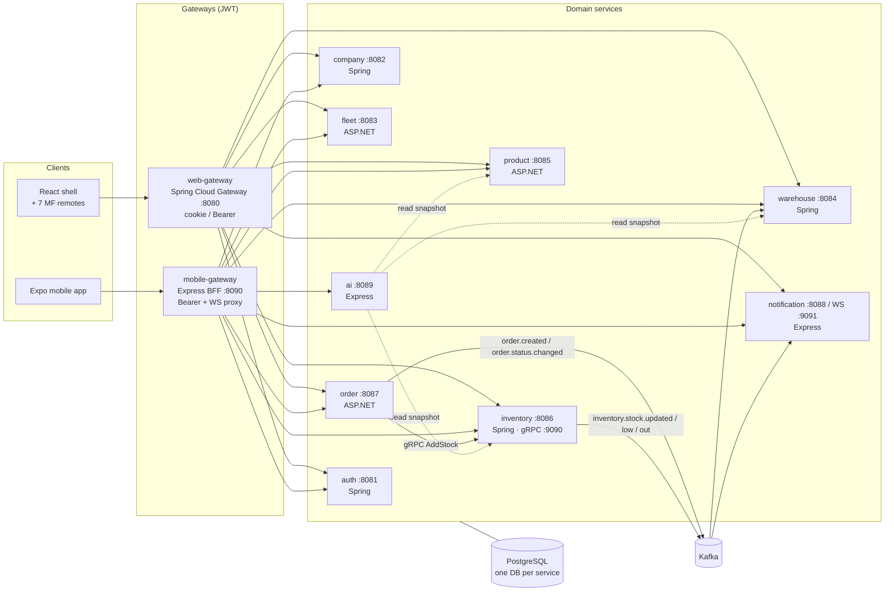

# Novo: Inventory & Supply ERP

A web and mobile platform for inventory, procurement (supply orders), warehouse and fleet management.

- **Backend:** nine polyglot microservices (Spring Boot, ASP.NET Core, Express/TypeScript). Each service owns its data, services talk over **gRPC** and **Kafka**, and two **JWT-authenticated gateways** sit in front of them.
- **Frontend:** a React **Module Federation** shell with seven feature remotes, an **Expo** mobile app, and shared TypeScript packages.
- **Ops:** PostgreSQL per service, Docker Compose for local runs, and OpenShift manifests for deployment.

> Status: this is a development project, not a hardened product. See [the project review](docs/PROJECT_REVIEW_AND_DOCUMENTATION.md) for known issues (R01–R24) and a stabilisation plan.

## Architecture

The system uses **microservices behind a BFF (backend-for-frontend) gateway per client**. Each bounded context is its own service with a database it owns. Calls that must complete before the request returns use gRPC, and side effects that can happen later go through Kafka events. On the frontend, a **micro-frontend** shell sits on the web side, and a separate native client sits on the mobile side.



### Architectural decisions

| Concern | Choice | Where |
|---|---|---|
| Service boundaries | One service per bounded context: auth, company, warehouse, inventory, fleet, product, order, notification, ai | `backend/services/*` |
| Data ownership | Database-per-service (8 PostgreSQL DBs; `ai-service` is stateless and reads through other services' APIs) | `deploy/local/compose.yaml` |
| Synchronous calls between services | gRPC with a shared `inventory.proto` contract | `inventory-service/src/main/proto`, `order-service/Protos` |
| Asynchronous integration | Kafka events for capacity projection and notifications | see *Events* below |
| Edge | One gateway per client type (BFF): web uses Spring Cloud Gateway, mobile uses Express | `backend/gateways/*` |
| AuthN | JWT access and refresh tokens issued by `auth-service` and validated at the gateways | `auth-service`, `gateways/*/…/Jwt*` |
| Service internals | Layered/clean: `domain` → `application` → `infrastructure` → `presentation` (inventory adds CQRS command/query handlers) | each service |
| Web UI | Vite Module Federation: the shell hosts seven remotes (auth, companies, warehouses, products, fleet, inventory, orders) | `frontend/web/*` |
| Shared frontend code | npm workspace packages for DTO types, domain (roles, order states, query keys) and i18n (SL/EN) | `frontend/packages/*` |
| Real-time | Kafka → notification-service → WebSocket (proxied by the mobile gateway); Expo push tokens | `notification-service` |
| Analytics | Inventory analysis and reorder suggestions, with an optional Azure OpenAI summary | `ai-service` |

### Events

| Topic | Producer | Consumer |
|---|---|---|
| `order.created`, `order.status.changed` | order | notification |
| `inventory.stock.updated` | inventory | warehouse (capacity) |
| `inventory.low`, `inventory.out` | inventory, warehouse | notification |

### Main flow: supply order

1. A user creates an order (product + company + warehouse + driver + quantity) through a gateway → `order-service`.
2. When the order is **approved**, `order-service` calls `inventory-service` over gRPC to add stock and publishes `order.status.changed`.
3. `inventory-service` publishes `inventory.stock.updated`, and `warehouse-service` updates its used capacity.
4. Threshold breaches emit `inventory.low` / `inventory.out`. `notification-service` stores them and pushes them over WebSocket or Expo push.

## Repository layout

```text
Novo/
├── README.md                     ← you are here
├── run-local.sh                  one-command local stack (wraps scripts/run_local.py)
├── .github/workflows/            ci.yml (build + test everything) · images.yml (push images for OpenShift)
│
├── backend/
│   ├── gateways/
│   │   ├── web-gateway/          Spring Cloud Gateway: web edge, JWT filter, routing
│   │   └── mobile-gateway/       Express/TS BFF: mobile edge, JWT, WS proxy, AI routes
│   ├── services/
│   │   ├── auth-service/         Spring Boot: users, login, tokens
│   │   ├── company-service/      Spring Boot: companies
│   │   ├── warehouse-service/    Spring Boot: warehouses, capacity (Kafka consumer)
│   │   ├── inventory-service/    Spring Boot: stock, thresholds (gRPC server, Kafka producer)
│   │   ├── fleet-service/        ASP.NET Core: drivers, vehicles
│   │   ├── product-service/      ASP.NET Core: products, categories, SKU
│   │   ├── order-service/        ASP.NET Core: orders, PDFs (gRPC client, Kafka producer)
│   │   ├── notification-service/ Express/TS: Kafka consumer, WebSocket, push tokens
│   │   └── ai-service/           Express/TS: inventory analytics, reorder suggestions
│   └── test-data/                seed scripts for sample business data
│
├── frontend/                     npm workspace root
│   ├── packages/                 api-types · domain · i18n (shared by web + mobile)
│   ├── web/
│   │   ├── shell/                Module Federation host
│   │   └── *-mf/                 7 feature remotes
│   └── mobile/                   Expo Router app (scanner, push, offline-aware)
│
├── deploy/
│   ├── local/                    compose.yaml (Postgres ×8, Kafka, optional .NET) + Dockerfile.dotnet
│   ├── docker/                   older all-in-containers compose.yaml + legacy nginx.conf
│   └── openshift/                manifests (config, Postgres, Kafka, services, gateways, frontend)
│
├── tests/
│   └── e2e/                      Playwright API integration tests
│
├── scripts/                      local launcher (Python) and its unit tests
│
└── docs/
    ├── PROJECT_REVIEW_AND_DOCUMENTATION.md   detailed review, API/event reference, findings
    ├── LOCAL_DEVELOPMENT.md                  launcher usage and troubleshooting
    ├── screenshots/                          UI screenshots
    └── archive/                              historical notes (not authoritative)
```

Unit and integration tests live next to the code they test: JUnit under `src/test` for the Spring services, `*.Tests` projects for the .NET services, `__tests__` folders for Node and React, and `frontend/mobile/__tests__` for the mobile app.

## Quick start

```bash
./run-local.sh            # Postgres + Kafka in Docker; services, gateways and web on the host
# open http://localhost:3000 when it prints STACK READY. Press q to stop.
```

See [docs/LOCAL_DEVELOPMENT.md](docs/LOCAL_DEVELOPMENT.md) for options (`--backend-only`, `--mobile`, `--dotnet docker`) and seeding.

## Ports

| Component | Port |
|---|---|
| Web shell / remotes | 3000 / 3001–3007 |
| web-gateway / mobile-gateway | 8080 / 8090 |
| auth · company · fleet · warehouse · product · inventory · order · notification · ai | 8081 · 8082 · 8083 · 8084 · 8085 · 8086 · 8087 · 8088 · 8089 |
| inventory gRPC / notification WS | 9090 / 9091 |
| Kafka | 9092 |
| PostgreSQL (auth … notification) | 5432–5439 |
