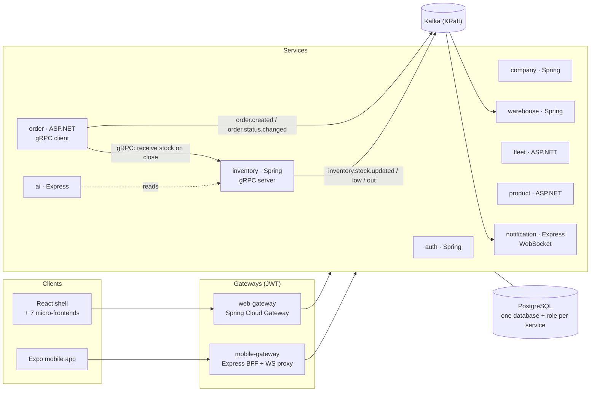

<div align="center">

# Inventory & Supply ERP

**Inventory, procurement, warehouse and fleet management, on the web and on the phone.**

Nine microservices in three languages behind two gateways, a micro-frontend web app and an Expo mobile app,
connected by gRPC and Kafka, running in Docker and on Kubernetes.

[](https://github.com/marko-spasovski/Inventory-Supply-Management/actions/workflows/e2e.yml)
[](https://github.com/marko-spasovski/Inventory-Supply-Management/actions/workflows/frontend.yml)
[](https://github.com/marko-spasovski/Inventory-Supply-Management/actions/workflows/repo-checks.yml)
<br>


</div>

## Contents

- [What it does](#what-it-does)
- [Screenshots](#screenshots)
- [Architecture](#architecture)
- [Tech stack](#tech-stack)
- [Security](#security)
- [Quick start](#quick-start)
- [Testing and CI](#testing-and-ci)
- [Deployment](#deployment)
- [Project status](#project-status)
- [Repository layout](#repository-layout)
- [Documentation](#documentation)

## What it does

- **Supply orders end to end.** A manager orders a product from a supplier into a warehouse, picks a driver, and approves it. The driver marks it delivered, a warehouse worker uploads the signed delivery note and closes it, and **closing receives the stock**. The lifecycle is enforced on the server, so stock is added exactly once.
- **Stock per product and warehouse**, with min/max thresholds, low- and out-of-stock warnings, and stock consumption for internal use with a PDF record.
- **Master data:** supplier companies, warehouses with capacity, products and categories with SKUs, drivers and vehicles.
- **Live notifications.** Order and stock events flow through Kafka into a notification feed, pushed to the browser and the phone over WebSocket.
- **Inventory analytics:** a stock summary and reorder suggestions, optionally explained in plain language by Azure OpenAI.
- **Mobile app** with a barcode/QR scanner for SKU lookup, push notifications and an offline-aware read cache.
- **Roles:** ADMIN, MANAGER, WORKER and DRIVER. Slovenian (default) and English.

## Screenshots

| | |
| --- | --- |
|  |  |
|  |  |
|  |  |
|  |  |

## Architecture

Microservices with a **backend-for-frontend gateway per client**. Each business area is one service that owns its
database. Calls that need an answer go over **gRPC**, and facts other services react to are **Kafka events**.



| Concern | Choice |
|---|---|
| Service boundaries | One service per business area; no service reads another's database. Enforced by PostgreSQL: each service's role can connect only to its own database. |
| Synchronous calls | gRPC with a shared `inventory.proto` (order → inventory), with a circuit breaker; a failed call leaves the order unchanged |
| Asynchronous integration | Kafka topics for capacity projection and notifications |
| Edge | Two gateways: Spring Cloud Gateway for web (httpOnly cookie), Express BFF for mobile (Bearer) |
| Service internals | Layered: domain → application → infrastructure → presentation; inventory uses CQRS command/query handlers |
| Web UI | Vite Module Federation: a shell loads seven independently built remotes |
| Shared frontend code | npm workspace packages for DTO types, domain rules (roles, order states) and i18n |
| Health | Every service exposes `/livez` and `/readyz` (503 when its database is down) |

Decisions and their reasons are recorded as [ADRs](docs/decisions/), and the full design is in [docs/architecture.md](docs/architecture.md).

## Tech stack

| Layer | Technology | Used for |
|---|---|---|
| Java services | **Java 21, Spring Boot 3.5**, Spring Data JPA, Spring Kafka, grpc-java | auth, company, warehouse, inventory |
| .NET services | **.NET 9, ASP.NET Core**, EF Core migrations, Polly, Grpc.Net.Client, Confluent.Kafka | fleet, product, order |
| Node services | **Node 24, TypeScript, Express**, KafkaJS, RxJS, ws, pg | notification, ai, mobile-gateway |
| Web gateway | **Spring Cloud Gateway** (WebFlux) | routing and authentication for the web app |
| Web | **React 19, Vite 5, Module Federation**, Vitest | shell + auth, companies, warehouses, products, fleet, inventory, orders |
| Mobile | **Expo 54 (React Native 0.81)**, expo-router, TanStack Query, Zustand, Jest | native app |
| Data and messaging | **PostgreSQL 16**, **Kafka 3.9 (KRaft)**, **gRPC/protobuf** | storage, events, the stock command |
| Analytics | Azure OpenAI (optional) | plain-language inventory summaries |
| Containers | **Docker**, multi-stage non-root images, docker compose | local stack, CI |
| Orchestration | **Kubernetes + Kustomize**: kind locally, **k3s** on a VPS, Traefik, cert-manager | deployment |
| CI | **GitHub Actions**: per-service pipelines, Semgrep, Trivy, gitleaks, actionlint, Playwright | quality gates |

## Security

| Area | What is done |
|---|---|
| Accounts | Passwords hashed with BCrypt. Public registration can only create WORKER accounts; the first ADMIN is created from environment variables. |
| Tokens | JWTs signed with a secret that exists only in the environment (never in source). The web app keeps its token in an httpOnly cookie; mobile uses Bearer. |
| Data ownership | One PostgreSQL role per service, with no CONNECT right on any other service's database. |
| Business rules | The order lifecycle is enforced on the server: invalid or repeated transitions are refused, and stock is received once. |
| Network | Only the web entry point and the gateways are exposed; Kubernetes NetworkPolicies keep the rest internal. nginx forwards only WebSocket upgrades and never trusts the client's Host header. |
| Containers | Every image runs as a non-root user; Kubernetes adds dropped capabilities, no privilege escalation and seccomp. |
| Supply chain | Actions pinned to commit SHAs and scanners to image digests. CI fails on a fixable CRITICAL vulnerability (Trivy), any Semgrep finding, a critical npm advisory, or any secret in git history (gitleaks). |

What is **not** done yet (for example, per-service role checks and driver ownership) is listed openly in
[docs/KNOWN_ISSUES.md](docs/KNOWN_ISSUES.md).

## Quick start

Needs Docker only.

```bash
git clone https://github.com/marko-spasovski/Inventory-Supply-Management.git
cd Inventory-Supply-Management
docker compose up --build --wait
```

| What | Where |
|---|---|
| Web app | http://localhost:3000 |
| Web API (gateway) | http://localhost:8080 |
| Mobile API (gateway) | http://localhost:8090 |
| Login (local only) | `admin@novo.local` / `admin-local-only` |

Stop with `docker compose down` (add `-v` to delete the data). For development with hot reload, `./run-local.sh`
runs the infrastructure in Docker and the apps on your machine ([guide](docs/LOCAL_DEVELOPMENT.md)).
For the mobile app, set `EXPO_PUBLIC_API_URL=http://<your-LAN-IP>:8090` and run `npm run mobile` in `frontend/`.

## Testing and CI

| Layer | Where | What it covers |
|---|---|---|
| Unit and slice tests | JUnit 5 + Mockito (Spring), xUnit + Moq (.NET), Jest (Node), Vitest + Testing Library (web), jest-expo (mobile) | domain rules (order lifecycle, registration roles), handlers, controllers, gRPC client behaviour, config, UI components |
| End-to-end | Playwright API tests in `tests/e2e` against the full stack | login → warehouse → category → product → stock; registration cannot create an ADMIN |
| Static analysis | Semgrep (Java, C#, TypeScript, React, nginx, Dockerfile, secrets, OWASP Top 10), `tsc`, ESLint (`rules-of-hooks`) | every PR |
| Supply chain | Trivy image and Dockerfile scans, `npm audit`, gitleaks over the full history | every PR |

Each service has its own path-filtered workflow built on a reusable pipeline per stack
(`.github/workflows/_java-service.yml`, `_dotnet-service.yml`, `_node-service.yml`). The e2e workflow starts the
whole stack on every PR. `release.yml` publishes every image to GHCR on each merge to `main`.
See [.github/README.md](.github/README.md) and [docs/testing/baseline.md](docs/testing/baseline.md).

## Deployment

```bash
# Local Kubernetes (kind): see deploy/k8s/README.md
kubectl apply -k deploy/k8s/overlays/local

# A VPS with k3s, Traefik and Let's Encrypt: see docs/operations/vps.md
kubectl apply -k deploy/k8s/overlays/vps
```

The whole stack uses about **2.3 GB of RAM**, measured, so it fits on a single 8 GB VPS with room to spare.

## Project status

| Area | Status |
|---|---|
| Business flow: orders, stock, master data, notifications, analytics | ✅ working; e2e tested |
| Critical security fixes: registration roles, secrets, order lifecycle, stock integrity | ✅ done |
| Containers, docker compose, Kubernetes manifests (kind + k3s) | ✅ done |
| CI: per-service pipelines, scans, e2e, image publishing | ✅ done |
| Per-service authorization, driver ownership, refresh-token revocation | 🟡 open: [KNOWN_ISSUES.md](docs/KNOWN_ISSUES.md) |
| Outbox and idempotent consumers, capacity projection | 🟡 open: [KNOWN_ISSUES.md](docs/KNOWN_ISSUES.md) |
| Spring Boot 4, ES256 + JWKS, Flyway | ⬜ planned |

## Repository layout

```text
backend/
  gateways/        web-gateway (Spring Cloud Gateway), mobile-gateway (Express BFF)
  services/        auth, company, warehouse, inventory (Spring) · fleet, product, order (ASP.NET)
                   notification, ai (Express)
  test-data/       seed scripts
frontend/          npm workspace
  packages/        api-types · domain · i18n (shared by web and mobile)
  web/             shell (Module Federation host) + 7 remotes, one nginx image
  mobile/          Expo app
deploy/
  k8s/             Kustomize base + overlays (local, vps)
  local/           compose file for ./run-local.sh
db/init/           one database and role per service
tests/e2e/         Playwright API tests
docs/              architecture, requirements, ADRs, known issues, operations, review
scripts/           local launcher
docker-compose.yml the whole stack in containers
```

## Documentation

| Document | What it covers |
|---|---|
| [docs/architecture.md](docs/architecture.md) | structure, runtime, identity, order flow, events, pipeline |
| [docs/requirements.md](docs/requirements.md) | roles, permission matrix, order lifecycle, stock rules |
| [docs/decisions/](docs/decisions/) | 11 architecture decision records |
| [docs/KNOWN_ISSUES.md](docs/KNOWN_ISSUES.md) | what is fixed, what is still open, and how to fix it |
| [docs/operations/vps.md](docs/operations/vps.md) | hosting on a VPS with k3s |
| [docs/PROJECT_REVIEW_AND_DOCUMENTATION.md](docs/PROJECT_REVIEW_AND_DOCUMENTATION.md) | the full technical review (findings R01–R24) |
| [docs/plans/remediation-plan.md](docs/plans/remediation-plan.md) | the improvement plan this work followed |
| [AGENTS.md](AGENTS.md) | conventions, commands and rules for contributors |
