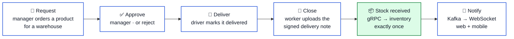
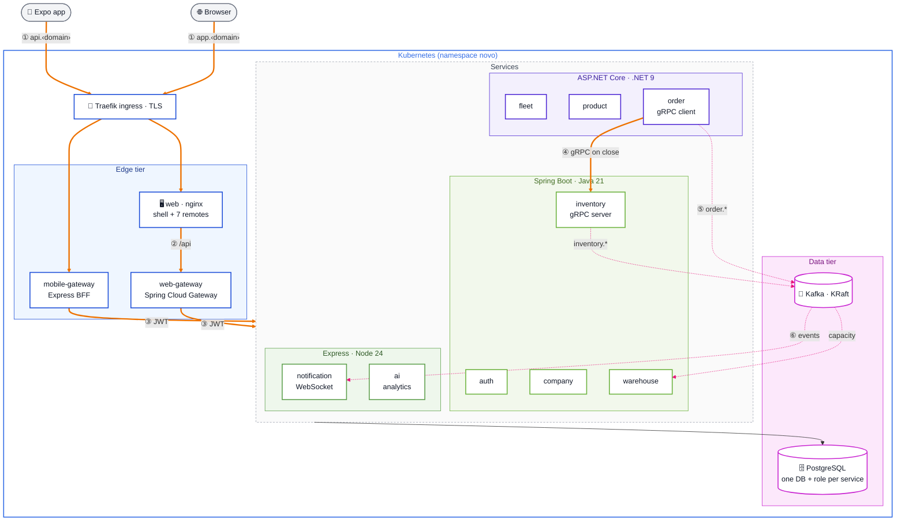
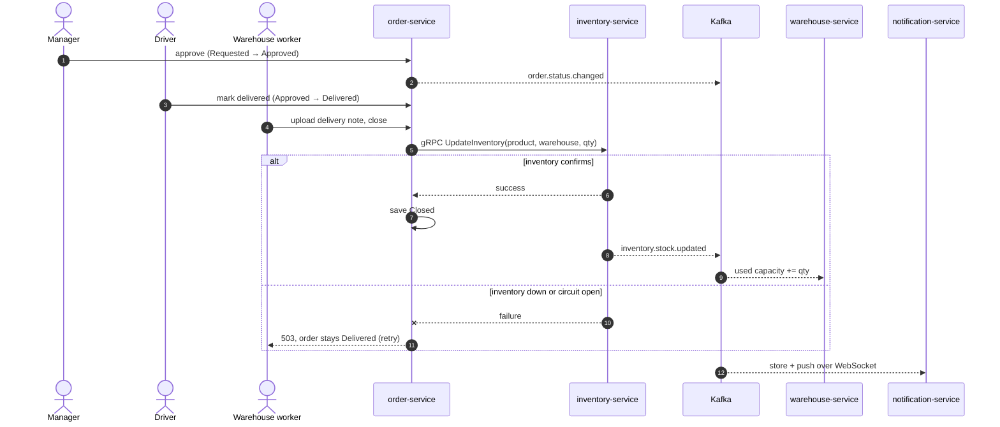

# Polyglot ERP Microservices

> An inventory and supply **ERP**: purchasing, stock, warehouses and a delivery fleet, built as **nine microservices in three languages** (Spring Boot, ASP.NET Core, Express/TypeScript). Two gateways sit in front of the services, a **React micro-frontend** web app and an **Expo** mobile app are the clients, and the services talk over **gRPC** and **Kafka**. It runs with **Docker Compose** and on **Kubernetes**, and every change passes CI gates for tests, SAST, image scanning and secret scanning.

[](https://github.com/marko-spasovski/polyglot-erp-microservices/actions/workflows/e2e.yml)
[](https://github.com/marko-spasovski/polyglot-erp-microservices/actions/workflows/frontend.yml)
[](https://github.com/marko-spasovski/polyglot-erp-microservices/actions/workflows/repo-checks.yml)


---

## Table of contents

- [Overview](#overview)
- [Screenshots](#screenshots)
- [Architecture](#architecture)
- [Tech stack](#tech-stack)
- [Project status](#project-status)
- [Repository layout](#repository-layout)
- [Getting started](#getting-started)
- [Security guardrails](#security-guardrails)
- [CI quality gates](#ci-quality-gates)
- [Documentation](#documentation)
- [Scope and known limitations](#scope-and-known-limitations)
- [Author](#author)
- [License](#license)

---

## Overview

The system follows one business flow end to end: a **supply order**, from request to the stock arriving on the shelf.



- **Polyglot by design:** each business area is its own service, in the stack that suits it: four Spring Boot services, three ASP.NET Core services and two Express/TypeScript services. Every service has its own Dockerfile, tests, CI workflow and database.
- **Two clients, two gateways:** a React shell loads seven independently built micro-frontends through Spring Cloud Gateway, and an Expo app (with a barcode scanner, push notifications and an offline read cache) goes through an Express backend-for-frontend.
- **Synchronous where it must be, events everywhere else:** receiving stock is a gRPC command with a circuit breaker, and everything that reacts later (warehouse capacity, notifications) consumes Kafka events.
- **Runs the same everywhere:** one `docker compose up --wait` locally, and the same images on Kubernetes (kind locally, k3s on a VPS), with health probes, non-root containers and NetworkPolicies.
- **Honest about gaps:** every open issue is in [`docs/KNOWN_ISSUES.md`](docs/KNOWN_ISSUES.md), with its risk and how to fix it.

---

## Screenshots

| | |
|---|---|
|  |  |
|  |  |
|  |  |
|  |  |

---

## Architecture

### Request path

The runtime on Kubernetes. [`docs/architecture.md`](docs/architecture.md) is the source of truth, and the decisions behind it are in [`docs/decisions/`](docs/decisions/).



**How to read it**

| Element | Meaning |
|---|---|
| 🟧 thick orange arrows ①–④ | the request path, one hop at a time, ending in the gRPC stock command |
| 🩷 dotted pink arrows ⑤–⑥ | Kafka events: warehouse capacity, and notifications pushed to clients over WebSocket |
| thin arrow | every service reads and writes its own PostgreSQL database |
| 🟦 blue box | the edge tier, the only pods a NetworkPolicy lets the ingress reach |
| 🟩 / 🟪 / 🟢 boxes | the three service stacks: Spring Boot, ASP.NET Core, Express |
| 🟣 pink box | PostgreSQL and Kafka, reachable only from inside the namespace |

**Request path, step by step**

1. The browser opens `app.<domain>`, and the phone calls `api.<domain>`. Traefik terminates TLS and routes to the edge tier only.
2. The web image's nginx serves the shell and the seven remotes, and proxies `/api` to the web gateway (the JWT travels in an httpOnly cookie).
3. The gateway verifies the JWT and routes to the owning service. The mobile gateway does the same with a Bearer token and also proxies the WebSocket.
4. Closing a delivered order is the goods receipt: order-service calls inventory-service over **gRPC** *before* saving, so an order is never closed without its stock, and stock is never added twice.
5. order-service and inventory-service publish Kafka events. warehouse-service updates capacity, and notification-service stores the notification.
6. notification-service pushes it to every connected browser and phone over WebSocket.

**Design principles**

- **A service owns its data.** Nine services, one database each, enforced by PostgreSQL itself: a service's role has no `CONNECT` right on any other database.
- **One way in.** Only the ingress is public. Services, PostgreSQL and Kafka are ClusterIP only, and NetworkPolicies let the ingress reach only the edge tier.
- **Business rules live on the server.** The order lifecycle (Requested → Approved → Delivered → Closed) is enforced in the domain, so invalid or repeated transitions are refused with `409`.
- **Fail visibly.** If inventory does not confirm a stock change, the order stays unchanged and the API answers `503`. Every service exposes `/livez` and `/readyz`, and readiness drops when its database is unreachable.

<details>
<summary>Show the order and stock sequence (approve → deliver → close)</summary>

<br/>



</details>

---

## Tech stack

| Layer | Technology | Role in the system |
|---|---|---|
| Java services | **Java 21**, **Spring Boot 3.5**, Spring Data JPA, Spring Kafka, grpc-java | auth (users, roles, JWT), company, warehouse (capacity), inventory (stock, gRPC server) |
| .NET services | **.NET 9**, **ASP.NET Core**, EF Core migrations, Polly, Grpc.Net.Client, Confluent.Kafka | fleet (drivers, vehicles), product (catalog, SKU), order (lifecycle, documents, gRPC client) |
| Node services | **Node 24**, **TypeScript**, **Express**, KafkaJS, RxJS, ws, pg | notification (feed, WebSocket, push tokens), ai (analytics, reorder suggestions) |
| Web gateway | **Spring Cloud Gateway** (WebFlux) | cookie JWT authentication and routing for the web app |
| Mobile gateway | **Express** BFF | Bearer JWT, response shaping, WebSocket proxy |
| Web | **React 19**, **Vite 5**, **Module Federation**, Vitest + Testing Library | shell + seven remotes: auth, companies, warehouses, products, fleet, inventory, orders |
| Mobile | **Expo 54** (React Native 0.81), expo-router, TanStack Query, Zustand | native app with scanner, push notifications and an offline read cache |
| Shared frontend | npm workspace packages | `api-types` (DTOs), `domain` (roles, order states), `i18n` (Slovenian, English) |
| Data and messaging | **PostgreSQL 16**, **Kafka 3.9 (KRaft)**, **gRPC / protobuf** | storage, events, the stock command |
| Analytics | **Azure OpenAI** (optional) | plain-language inventory summaries |
| Containers | **Docker**, multi-stage non-root images, **Docker Compose** | local stack and CI |
| Orchestration | **Kubernetes** + **Kustomize**, **kind**, **k3s**, Traefik, cert-manager | local cluster and single-VPS hosting |
| CI/CD | **GitHub Actions**, Semgrep, Trivy, gitleaks, actionlint, kubeconform, Playwright, GHCR | quality gates and image publishing |

---

## Project status

**Current state:** working end to end in Docker Compose and on Kubernetes, with every CI gate green. The open work is tracked in [`docs/KNOWN_ISSUES.md`](docs/KNOWN_ISSUES.md).

| Component | Status |
|---|---|
| Business flow: orders, stock, master data, notifications, analytics | ✅ working; e2e tested through the gateway |
| Critical fixes: registration roles (R01), secrets (R03), order lifecycle (R04), stock integrity (R05) | ✅ done |
| Monorepo, standards, ADRs, per-service CI with SAST and scans | ✅ done |
| Docker Compose full stack; Kubernetes manifests (kind + k3s overlays) | ✅ verified: all pods ready, e2e 3/3 on kind |
| Image publishing to GHCR on every merge | ✅ done |
| Per-service authorization, driver ownership, refresh-token revocation | 🟡 open: see known issues |
| Outbox and idempotent consumers, capacity projection, notification read state | 🟡 open: see known issues |
| Spring Boot 4, ES256 + JWKS, Flyway migrations | ⬜ planned |
| Production deployment on a VPS | ⏭️ next: [`docs/operations/vps.md`](docs/operations/vps.md) |

---

## Repository layout

```text
polyglot-erp-microservices/
├── backend/
│   ├── gateways/
│   │   ├── web-gateway/        # Spring Cloud Gateway: cookie JWT, routing
│   │   └── mobile-gateway/     # Express BFF: Bearer JWT, WebSocket proxy, AI routes
│   ├── services/               # auth, company, warehouse, inventory (Spring) · fleet, product, order (.NET)
│   │                           # notification, ai (Express); each with Dockerfile, tests, /livez + /readyz
│   └── test-data/              # seed scripts for demo data
├── frontend/                   # one npm workspace
│   ├── packages/               # api-types · domain · i18n, shared by web and mobile
│   ├── web/                    # shell (Module Federation host) + 7 remotes, one nginx image
│   └── mobile/                 # Expo app
├── deploy/
│   ├── k8s/                    # Kustomize base + overlays: local (kind), vps (k3s + Traefik + TLS)
│   └── local/                  # compose file for ./run-local.sh
├── db/init/                    # one database and one role per service
├── tests/e2e/                  # Playwright API tests through the gateway
├── docs/                       # architecture, requirements, ADRs, known issues, operations
├── .github/workflows/          # per-service pipelines, frontend, e2e, repo checks, release
├── docker-compose.yml          # the whole stack in containers
└── run-local.sh                # dev launcher: infrastructure in Docker, apps on the host
```

---

## Getting started

> [!NOTE]
> Only **Docker** is required. The default credentials below are local-only and are set in `docker-compose.yml`. Never reuse them anywhere else.

### Prerequisites

- **Docker** with Compose v2, and about 4 GB of free RAM (the whole stack uses about 2.3 GB)
- For Kubernetes: **kind** and **kubectl**
- For mobile development: **Node 24** (`nvm use`) and the Expo Go app

### Run everything with Docker Compose

```bash
# 1. Clone and start: builds all images and waits for every health check
git clone https://github.com/marko-spasovski/polyglot-erp-microservices.git
cd polyglot-erp-microservices
docker compose up --build --wait

# 2. Open the web app and log in
#    http://localhost:3000   admin@novo.local / admin-local-only
#    web API: http://localhost:8080   mobile API: http://localhost:8090

# 3. Run the end-to-end tests against it
cd tests/e2e && npm ci && npx playwright test
```

### Run it on Kubernetes (kind)

```bash
docker compose build
kind create cluster --name novo
for s in auth-service company-service warehouse-service inventory-service fleet-service product-service \
         order-service notification-service ai-service web-gateway mobile-gateway web; do
  kind load docker-image --name novo "novo-$s:latest"
done
kubectl apply -k deploy/k8s/overlays/local
kubectl -n novo wait --for=condition=available deployment --all --timeout=15m
kubectl -n novo port-forward svc/web 3000:8080
```

### Teardown

```bash
docker compose down            # add -v to delete the data
kind delete cluster --name novo
```

For development with hot reload, use `./run-local.sh` ([guide](docs/LOCAL_DEVELOPMENT.md)). To host it on a VPS
with k3s, a domain and HTTPS, follow [`docs/operations/vps.md`](docs/operations/vps.md).

---

## Security guardrails

| Guardrail | How it's enforced |
|---|---|
| No privilege escalation at sign-up | public registration always creates a WORKER; the first ADMIN comes from environment variables |
| No secrets in the repo | the JWT secret and database passwords come only from the environment or Kubernetes Secrets; `gitleaks` scans the full history in CI |
| Data ownership | one PostgreSQL role per service, with no `CONNECT` right on other services' databases |
| Server-side business rules | the order lifecycle is enforced in the domain; repeated or invalid transitions are `409` |
| Minimal exposure | only the ingress is public; NetworkPolicies limit it to the edge tier; services are ClusterIP |
| Hardened containers | every image runs as non-root; Kubernetes adds dropped capabilities, no privilege escalation, seccomp and memory limits |
| Hardened edge | nginx forwards only WebSocket upgrades (no h2c smuggling), never trusts the client's Host header, and sends nosniff and frame-deny headers |
| Patched dependencies | CI fails on a fixable CRITICAL CVE (Trivy) or a critical npm advisory; accepted exceptions have a reason and an expiry date in `.trivyignore` |

---

## CI quality gates

Every pull request must pass these checks before merging to `main`:

| Check | What it catches |
|---|---|
| Unit and slice tests per service | JUnit 5 (Spring), xUnit (.NET), Jest (Node), Vitest (web) and jest-expo (mobile) regressions |
| `tsc --noEmit`, ESLint `rules-of-hooks` | type errors and React hook misuse in services, web and mobile |
| Semgrep (explicit rule packs) | insecure code in Java, C#, TypeScript, React, nginx and Dockerfiles; OWASP Top 10 |
| Trivy image + Dockerfile scans | fixable CRITICAL vulnerabilities and container misconfigurations |
| `npm audit` | critical advisories in production dependencies |
| gitleaks (full history) | committed secrets |
| actionlint | broken or unsafe workflow definitions |
| kustomize + kubeconform | invalid Kubernetes manifests in both overlays |
| e2e (Playwright) | the full stack started with Compose, then login → warehouse → product → stock, and registration cannot create an ADMIN |

Each service has its own path-filtered workflow built on a reusable pipeline per stack. Actions are pinned to commit SHAs and scanners to image digests. Branches follow Conventional Commits (`feat:`, `fix:`, `docs:`, `chore:`, `ci:`, `test:`), one change per pull request.

---

## Documentation

| Document | Purpose |
|---|---|
| [`architecture.md`](docs/architecture.md) | **source of truth**: structure, runtime, identity, order flow, events, pipeline |
| [`requirements.md`](docs/requirements.md) | roles, permission matrix, order lifecycle, stock and capacity rules |
| [`decisions/`](docs/decisions/) | 11 architecture decision records (context · decision · alternatives · consequences) |
| [`KNOWN_ISSUES.md`](docs/KNOWN_ISSUES.md) | what is fixed, what is still open, and how to fix each item |
| [`operations/vps.md`](docs/operations/vps.md) | hosting on a VPS: k3s, DNS, TLS, deploy, rollback, backups |
| [`deploy/k8s/README.md`](deploy/k8s/README.md) | Kubernetes manifests and the kind workflow |
| [`testing/baseline.md`](docs/testing/baseline.md) | the test baseline and how failing tests were handled |
| [`LOCAL_DEVELOPMENT.md`](docs/LOCAL_DEVELOPMENT.md) | the hot-reload launcher |
| [`ci.md`](docs/ci.md) | every CI workflow, its gates and the accepted exceptions |
| [`PROJECT_REVIEW_AND_DOCUMENTATION.md`](docs/PROJECT_REVIEW_AND_DOCUMENTATION.md) | the full technical review (findings R01–R24) |
| [`plans/remediation-plan.md`](docs/plans/remediation-plan.md) | the improvement roadmap |
| [`AGENTS.md`](AGENTS.md) | conventions, commands and non-negotiables for contributors |

---

## Scope and known limitations

This is a portfolio project that shows service design across several technology stacks. It is not a hardened production product. Everything critical is fixed, and the remaining gaps (for example, role checks inside each service, driver ownership of orders, and the transactional outbox) are listed openly in [`docs/KNOWN_ISSUES.md`](docs/KNOWN_ISSUES.md), each with its risk, the code it affects and the fix. The default credentials in the repository are for local development only.

---

## Author

**Marko Spasovski**: designed and built as a polyglot microservices project covering service design in Java, .NET and Node, micro-frontends, a native mobile app, event-driven integration with Kafka and gRPC, and delivery with Docker, Kubernetes and CI quality gates.

[GitHub](https://github.com/marko-spasovski) · [LinkedIn](https://www.linkedin.com/in/marko-spasovski2/)

---

## License

No license has been chosen yet. Until one is added, all rights are reserved.
