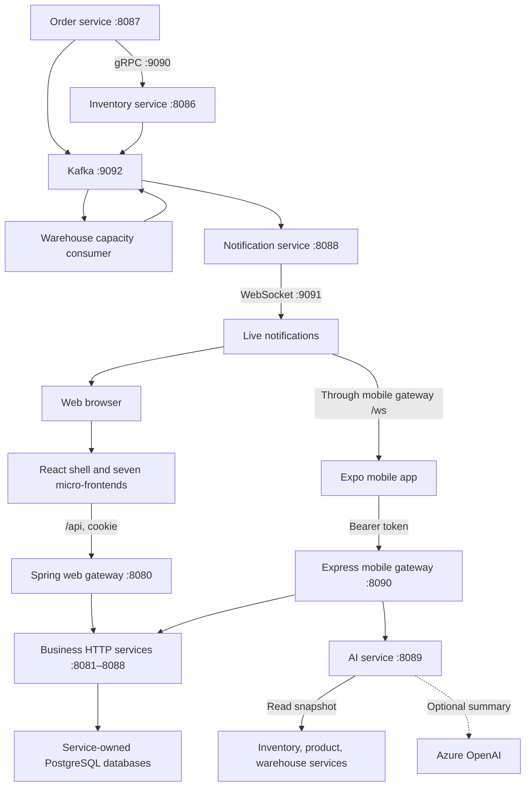
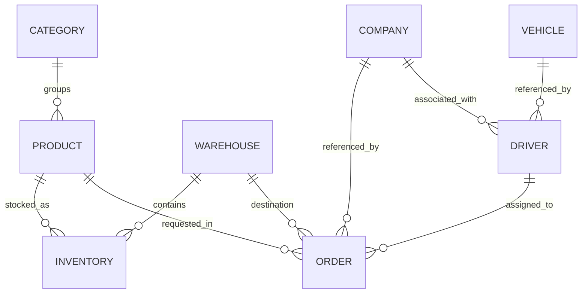
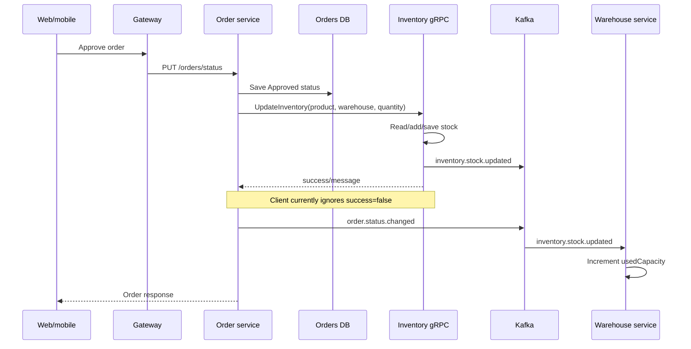

# Novo — project documentation and technical review

Reviewed on **4 October 2026** against the files in this workspace.

This guide covers `frontend/`, `backend/`, `deploy/`, `tests/` and `docs/archive/` (the last three were formerly the `moze da poceka/` folder; see the note in section 12). It explains the current implementation, the connections between components, the problems found, and a practical order for continuing development.

**Assessment: the project has a substantial implementation, but everything is not correct yet.** The main business modules exist, and the architectural connections are recognizable. However, the supplied setup is not reproducible as documented, permissions are inconsistent, and several stock and notification flows can produce incorrect results. Treat this as a development project requiring stabilization before relying on it for real operations.

**Review boundary:** application source, existing documentation, configuration, and dependency files were left unchanged. This Markdown document is the only addition to the project. No services were launched, databases seeded, dependencies installed, or deployments performed. Findings are based on source tracing and the limited checks described in section 13; this is not a claim that every screen or service has passed a runtime test.

## Contents

1. [Start here](#1-start-here)
2. [What the project does](#2-what-the-project-does)
3. [Repository map](#3-repository-map)
4. [Architecture and connections](#4-architecture-and-connections)
5. [Services, ports, and data ownership](#5-services-ports-and-data-ownership)
6. [Frontend structure](#6-frontend-structure)
7. [API and event reference](#7-api-and-event-reference)
8. [Important business flows](#8-important-business-flows)
9. [Roles and access control](#9-roles-and-access-control)
10. [Review findings and improvements](#10-review-findings-and-improvements)
11. [Local development and deployment](#11-local-development-and-deployment)
12. [What was in moze da poceka](#12-what-was-in-moze-da-poceka)
13. [Verification and testing](#13-verification-and-testing)
14. [A gradual development plan](#14-a-gradual-development-plan)
15. [Decisions to make before expanding features](#15-decisions-to-make-before-expanding-features)
16. [Glossary](#16-glossary)

## 1. Start here

Read sections 2–5 first to understand the system. Then follow the order flow in section 8 while opening the linked source files. Read the findings before attempting a full startup: some old instructions refer to folders and scripts that are absent here.

The highest priorities are:

| Priority | Work | Why it comes first |
|---|---|---|
| 1 | Establish one working local setup | The current Compose file cannot build the supplied frontend layout. |
| 2 | Fix registration, JWT configuration, and backend permissions | A caller can request privileged registration, and different gateways enforce different policies. |
| 3 | Make order approval and stock updates reliable | Repeated approval can add stock repeatedly; failures can leave an approved order without its stock update. |
| 4 | Fix inventory invariants and capacity accounting | Initial stock validation and concurrency protection are incomplete; capacity does not track all stock mutations. |
| 5 | Repair notification contracts and event processing | Mobile message bodies and targeted cache refreshes do not match the server payload. |
| 6 | Repair tests and document a verified baseline | Existing test files do not establish that current behavior is correct. |
| 7 | Improve usability, maintainability, and deployment | Do this after the important behavior is trustworthy. |

Keep the existing structure while learning it. A wholesale rewrite or another architectural layer would make it harder to distinguish existing problems from new ones.

## 2. What the project does

This is an inventory and supply management application with web and mobile clients. Its main concepts are companies, warehouses, products and categories, vehicles and drivers, stock, supply orders, and notifications.

The implemented business journey is broadly:

1. Register and log in.
2. Create reference data: companies, warehouses, categories, products, vehicles, and drivers.
3. Create an order linking a product, company, warehouse, and driver to a quantity.
4. Approve or reject the order.
5. On approval, the backend adds inventory through gRPC and publishes a capacity update through Kafka.
6. Advance an approved order to delivered, then upload a document and close it through the UI.
7. Consume stock separately through the inventory screen.
8. Receive notifications and, on mobile, inspect inventory analysis and scan product codes.

Two distinctions matter:

- **Current stock changes on approval.** Older comments and documents say it changes when an order closes. The current `OrderService` checks `Status.Approved`.
- **The project is not demonstrably a multi-tenant ERP.** A `Company` is business data referenced by orders and drivers. There is no consistent user-to-company ownership boundary in the inspected API flows. Do not assume one company's users cannot see another company's records.

Good foundations already present include separate service data ownership, application/domain/infrastructure layers, gateway adapters for mobile, shared frontend packages, bilingual strings, a matching gRPC wire contract, and tests across the different technology stacks.

## 3. Repository map

```text
Novo/
├── README.md                            Entry point: architecture and layout
├── run-local.sh                         One-command local stack (wraps scripts/run_local.py)
├── docs/
│   ├── PROJECT_REVIEW_AND_DOCUMENTATION.md   This guide
│   ├── LOCAL_DEVELOPMENT.md             Launcher usage and troubleshooting
│   └── archive/                         Historical notes (not authoritative)
├── backend/
│   ├── gateways/
│   │   ├── web-gateway/                 Spring Cloud Gateway (web, cookie JWT)
│   │   └── mobile-gateway/              Express/TypeScript BFF (mobile, bearer JWT)
│   ├── services/
│   │   ├── auth-service/                Java
│   │   ├── company-service/             Java
│   │   ├── warehouse-service/           Java
│   │   ├── inventory-service/           Java + gRPC server
│   │   ├── fleet-service/               C#
│   │   ├── product-service/             C#
│   │   ├── order-service/               C# + gRPC client
│   │   ├── notification-service/        TypeScript + Kafka + WebSocket
│   │   └── ai-service/                  TypeScript inventory analysis
│   └── test-data/                       Scripts that create sample business data
├── frontend/
│   ├── package.json                     npm workspace root
│   ├── package-lock.json                Shared frontend dependency lock
│   ├── tsconfig.base.json               Shared TypeScript aliases
│   ├── packages/
│   │   ├── api-types/                   Shared TypeScript DTO declarations
│   │   ├── domain/                      Roles, features, query keys, order states
│   │   └── i18n/                        Slovenian and English strings
│   ├── web/
│   │   ├── shell/                       Web entry point and navigation (MF host)
│   │   ├── auth-mf/                     Login and registration
│   │   ├── companies-mf/
│   │   ├── warehouses-mf/
│   │   ├── products-mf/                 Products and categories
│   │   ├── fleet-mf/                    Drivers and vehicles
│   │   ├── inventory-mf/                Stock, thresholds, consumption
│   │   ├── orders-mf/
│   │   ├── Dockerfile.openshift         Combined web image
│   │   └── nginx.openshift.conf         Combined web/API/WebSocket entry point
│   └── mobile/                          Expo Router app
├── deploy/
│   ├── local/                           compose.yaml + Dockerfile.dotnet used by run-local.sh
│   ├── docker/                          Older full-stack compose.yaml + legacy nginx.conf
│   └── openshift/                       Deployment instructions and YAML manifests
├── tests/
│   └── e2e/                             Playwright API integration tests
└── scripts/                             Local launcher and its tests
```

There is an npm workspace at `frontend/`, but no project-wide build orchestrator at `Novo/`. The Java and C# projects and the three backend Node projects have their own build boundaries.

Git could not identify this workspace as a repository. Consequently, this review cannot identify a branch, commit, tracked-file status, or previous changes. Content hashes were used to verify that existing project files stayed unchanged during the original documentation work. (Folders were later reorganised; see section 12.)

## 4. Architecture and connections

### 4.1 Overall system



The diagram groups HTTP services for readability; each service owns its own application code and persistence. Kafka carries asynchronous events, whereas gRPC is a direct request from order-service to inventory-service.

### 4.2 Web request path

For a warehouse request during local shell development:

```text
warehouses-mf running inside the shell
  → fetch('/api/warehouses', credentials: 'include')
  → shell Vite proxy removes /api
  → web-gateway :8080 /warehouses
  → JWT cookie validated
  → X-User-Id / X-User-Email / X-User-Role injected
  → warehouse-service :8084 /warehouses
  → warehouses PostgreSQL database
```

The shell loads the feature applications through Module Federation. This means loading a remote JavaScript module into the page, not calling another backend. Once loaded, a feature app's relative `/api` requests use the shell page's origin.

On OpenShift, the intended frontend nginx serves the shell and all seven remotes from one host. It forwards `/api/` to the web gateway and `/ws` directly to notification-service. The web gateway itself has no WebSocket route in its supplied route configuration.

Entry points: [shell Vite configuration](../frontend/web/shell/vite.config.ts), [web gateway routes](../backend/gateways/web-gateway/src/main/resources/application.yaml), [JWT filter](../backend/gateways/web-gateway/src/main/java/com/marko/logistics/gateway/filter/JwtAuthenticationFilter.java), [OpenShift nginx](../frontend/web/nginx.openshift.conf).

### 4.3 Mobile request path

```text
Expo screen
  → lib/api module
  → shared Axios client attaches Authorization: Bearer ...
  → mobile-gateway :8090
  → JWT validated and identity headers injected
  → route translated when needed
  → business service
```

Examples of translation are `/stock` to `/inventory`, `/warehouses/summary` to `/warehouses/total`, and `/orders/:id/status` to `/orders/status` with the order ID inserted into the body.

Entry points: [mobile HTTP client](../frontend/mobile/lib/http/client.ts), [gateway startup and mounts](../backend/gateways/mobile-gateway/src/index.ts), [gateway route adapters](../backend/gateways/mobile-gateway/src/routes).

### 4.4 Internal architecture patterns

Java company/warehouse/auth services and C# fleet/product services use variations of ports and adapters:

```text
Controller → application service/use case → repository port → persistence adapter → database
                         ↓
                     domain model
```

Inventory uses command handlers for writes and query handlers for reads. This is a CQRS-style code organization; it does not mean that inventory has separate read and write databases. Order-service uses interfaces with application services, an EF repository, a gRPC client, document storage, and a Kafka producer. Notification-service wraps Kafka callbacks and persistence in RxJS streams.

## 5. Services, ports, and data ownership

### 5.1 Runtime inventory

Versions below are declarations in the supplied project files, not compatibility or support-lifecycle certifications.

| Component | Technology | Default local port | Main responsibility |
|---|---|---:|---|
| Web shell | React 18, Vite 5, Module Federation | 3000 | Navigation, session UI, remote loading, notification panel |
| Web remotes | React 18, Vite 5 | 3001–3007 | Feature screens |
| Mobile | Expo 54, React 19.1, React Native 0.81.5 | Expo-managed | Native screens and device features |
| Web gateway | Java 21, Spring Boot 3.5.11, Spring Cloud Gateway | 8080 | Web routing, cookie/Bearer authentication |
| Auth | Java 21, Spring Boot 3.5.11 | 8081 | Users, password verification, access and refresh tokens |
| Company | Java 21, Spring Boot 3.5.11 | 8082 | Company CRUD and totals |
| Fleet | .NET 9, EF Core | 8083 | Drivers, vehicles, driver lookup by signed-in email |
| Warehouse | Java 21, Spring Boot 3.5.11 | 8084 | Warehouse CRUD and capacity projection |
| Product | .NET 9, EF Core | 8085 | Products, SKU lookup, categories |
| Inventory | Java 21, Spring Boot 3.5.11 | 8086; gRPC 9090 | Stock, thresholds, consumption |
| Order | .NET 9, EF Core, Polly | 8087 | Orders, status changes, PDF uploads, gRPC and events |
| Notification | Express, TypeScript, RxJS, KafkaJS, pg, ws | HTTP 8088; WS 9091 | Event-derived notifications and device-token registration |
| AI | Express, TypeScript | 8089 | Read-only inventory analysis and optional generated narrative |
| Mobile gateway | Express, TypeScript | 8090 | Bearer auth, mobile API adaptation, WS proxy |
| Kafka | Compose: Confluent 7.6.1 with ZooKeeper | 9092 | Event transport |
| ZooKeeper | Compose infrastructure | 2181 | Local Kafka coordination |
| Legacy nginx | nginx | 8888 | Old proxy to a hardcoded host and Angular port 4200 |

Web remote ports are auth 3001, warehouses 3002, inventory 3003, orders 3004, companies 3005, fleet 3006, and products 3007.

### 5.2 Databases and files

| Owner | Database | Local host port | Important data |
|---|---|---:|---|
| Auth | `users` | 5432 | User ID, name, email, password hash, role |
| Company | `companies` | 5433 | Company contact records |
| Fleet | `fleet` | 5434 | Drivers and vehicles |
| Warehouse | `warehouses` | 5435 | Warehouse location, total and used capacity |
| Product | `products` | 5436 | Categories and products |
| Inventory | `inventory` | 5437 | Product/warehouse stock rows and thresholds |
| Order | `orders` | 5438 | Orders and lifecycle timestamps |
| Notification | `notifications` | 5439 | Notifications and registered device tokens |

Compose uses eight PostgreSQL 16 containers with named database volumes. OpenShift instead describes one PostgreSQL 15 instance containing eight logical databases. These are different deployment shapes and should be tested explicitly.

Java services use Hibernate `ddl-auto: update` in their development configuration. The C# services contain EF migrations and apply migrations at startup. Notification-service creates its tables through startup initialization. There is no single migration command covering the whole project.

Order PDFs and consumption PDFs are filesystem data, not records safely embedded in the service databases. The supplied order configuration contains an absolute path from the older checkout. OpenShift directs documents into `/tmp` without a persistent document volume. Backing up PostgreSQL alone would not back up these files.

### 5.3 Logical relationships



This is a logical map, not a claim that the relationships all have foreign-key enforcement. Cross-service IDs are mostly UUID/string references across separate databases. Order creation does not validate all of those remote references. A user and driver are currently associated by matching email for `/drivers/me`, rather than by a durable user-ID relationship.

An inventory row identifies a product in a warehouse with `quantity`, optional `minQuantity`, and optional `maxQuantity`. The inspected JPA entity does not define a unique product/warehouse constraint or an optimistic-lock version field.

## 6. Frontend structure

### 6.1 Shared packages

| Package | Actual role | Important limitation |
|---|---|---|
| `@erp/api-types` | TypeScript DTO declarations used by mobile | Some declarations do not match the HTTP payload; TypeScript does not validate JSON at runtime. |
| `@erp/domain` | Four roles, feature matrix, order status mappings, query keys | Frontend policy is not a substitute for server authorization. Web still duplicates parts of this logic. |
| `@erp/i18n` | SL/EN dictionaries and locale helpers | The default is Slovenian; several tests and hardcoded strings have not followed the migration. |

These packages expose TypeScript source through `main` and `types`. They are workspace-local packages, not independently published build artifacts. App manifests generally do not declare their `@erp/*` imports as dependencies, so isolated builds cannot assume those packages will appear automatically.

Web apps use React 18 while mobile uses React 19. That is not automatically wrong because they run in separate environments. It does mean that install, testing, and module resolution need to preserve those boundaries. Avoid forcing every workspace onto the same React version merely to silence dependency errors.

### 6.2 Web

The shell's [App.tsx](../frontend/web/shell/src/App.tsx) owns routes and lazy-loads each remote. [Layout.tsx](../frontend/web/shell/src/components/Layout.tsx) owns navigation, language controls, logout, and the notification panel.

The login remote stores user display information under `mf_user` in localStorage. The actual session token is an HttpOnly `AUTH_TOKEN` cookie. The shell checks localStorage to decide whether to display protected screens; it does not verify the cookie with the backend on startup. This can leave a logged-in-looking interface after the cookie expires.

The web feature applications largely keep UI, fetch calls, forms, validation, and local types together in one `App.tsx`. This is manageable for a prototype but increasingly difficult to test and change. Inventory and orders are each over 400 lines in the current snapshot.

Web localization uses the shared dictionary, localStorage key `erp_locale`, and a custom `erp:locale-changed` event to synchronize remotes within the page. Existing per-app hooks are deliberately duplicated; shared message data is the common source.

### 6.3 Mobile

The principal route groups are:

| Location | Purpose |
|---|---|
| `app/(auth)` | Login and registration |
| `app/(tabs)/index.tsx` | Dashboard |
| `app/(tabs)/stock` | Inventory and consumption |
| `app/(tabs)/orders` | Order list, create, detail, status actions |
| `app/(tabs)/notifications.tsx` | Notification inbox |
| `app/(tabs)/more` | Products, categories, companies, warehouses, fleet, scanner, profile |

Mobile uses React Query for server data, Zustand for authentication/local state, and Axios for HTTP. API wrappers under `lib/api` are the first place to inspect when a screen sends the wrong URL or expects the wrong response.

The HTTP client implements a shared in-flight refresh request: when a non-auth request receives 401, it attempts to exchange the refresh token and retries once. Both tokens are persisted in AsyncStorage. Although `expo-secure-store` is listed as a dependency, it is not the store used by this authentication implementation.

Device-specific extras have different levels of completion:

| Feature | Current implementation |
|---|---|
| Barcode/QR scanning | Scanner and parsing helpers resolve products, including SKU lookup through the mobile gateway. |
| AI analysis | Aggregates inventory, product, and warehouse data; returns deterministic recommendations and optional Azure narrative. |
| Live notifications | WebSocket client with reconnect and HTTP polling fallback; contract problems are documented below. |
| Push notifications | Requests/registers Expo tokens; no backend push-delivery worker is wired. |
| Offline behavior | Connectivity banner and in-memory query cache; no demonstrated durable offline database or queued write synchronization. |
| Localization | SL/EN shared strings and a persisted locale; changing language remounts the navigation tree. |

Do not describe push delivery or durable offline operation as completed features yet.

## 7. API and event reference

### 7.1 HTTP routing

In the table below, “web” means the browser URL including `/api`. The Spring gateway receives the same URL without `/api`. Mobile calls its gateway without that prefix.

| Operation | Web | Mobile | Service endpoint |
|---|---|---|---|
| Register/login/logout/refresh | `POST /api/auth/{action}` | `POST /auth/{action}` | Same `/auth/{action}` |
| Company list/create | `GET/POST /api/companies` | `GET/POST /companies` | `/companies` |
| Company detail/update/delete | `/api/companies/:id` | `/companies/:id` | `/companies/:id` |
| Company total | `GET /api/companies/total` | Generic `GET /companies/:id` route can forward `total` | `/companies/total` |
| Warehouse list/create | `GET/POST /api/warehouses` | `GET/POST /warehouses` | `/warehouses` |
| Warehouse detail/update/delete | `/api/warehouses/:id` | `/warehouses/:id` | `/warehouses/:id` |
| Warehouse total | `GET /api/warehouses/total` | `GET /warehouses/summary` | `/warehouses/total` |
| Product CRUD | `/api/products[/:id]` | `/products[/:id]` | `/products[/:id]` |
| Product by SKU | `GET /api/products/by-sku?sku=...` | `GET /products/by-sku?sku=...` | `/products/by-sku` |
| Category CRUD | `/api/categories[/:id]` | `/categories[/:id]` | `/categories[/:id]` |
| Driver CRUD | `/api/drivers[/:id]` | `/drivers[/:id]` | `/drivers[/:id]` |
| Driver self lookup | `GET /api/drivers/me` | `GET /drivers/me` | `/drivers/me` |
| Vehicle CRUD | `/api/vehicles[/:id]` | `/vehicles[/:id]` | `/vehicles[/:id]` |
| Inventory list | `GET /api/inventory` | `GET /stock` | `/inventory` |
| Inventory by warehouse | `GET /api/inventory/:warehouseId` | `GET /stock/:warehouseId` | `/inventory/:warehouseId` |
| Add stock | `POST /api/inventory` | `POST /stock` | `POST /inventory` |
| Set thresholds | `PUT /api/inventory/thresholds` | `PUT /stock/thresholds` | `/inventory/thresholds` |
| Consume stock | `POST /api/inventory/consume` | `POST /stock/consume` | `/inventory/consume`, multipart |
| Orders list/create | `GET/POST /api/orders` | `GET/POST /orders` | `/orders` |
| Order detail | `GET /api/orders/:id` | `GET /orders/:id` | `/orders/:id` |
| Status change | `PUT /api/orders/status` | `PUT /orders/:id/status` | `PUT /orders/status` |
| Upload order PDF | `POST /api/orders/upload-document` | `POST /orders/upload-document` | `/orders/upload-document`, multipart |
| Notification list/unread | `/api/notifications[/unread]` | `/notifications[/unread]` | Same without `/api` |
| Mark notifications read | `PATCH /api/notifications/:id/read` or `/read-all` | Same without `/api` | Same without `/api` |
| WebSocket ticket | `GET /api/notifications/ws-ticket` | No dedicated mobile HTTP route; mobile uses its access token | `/notifications/ws-ticket` |
| Device registration | `POST /api/notifications/device-tokens` routes through web gateway | `POST /notifications/device-tokens` | Same without `/api` |
| Remove device token | `DELETE /api/notifications/device-tokens/:token` routes through web gateway | Same without `/api` | Same without `/api` |
| Inventory analysis | Not routed by the web gateway | `GET /ai/inventory-summary` | AI `/ai/inventory-summary` |
| Reorder suggestion | Not routed by the web gateway | `POST /ai/reorder-suggestion` | AI `/ai/reorder-suggestion` |

This is a source-derived routing reference, not a statement that every route has been tested successfully.

### 7.2 Payload details that are easy to get wrong

- Login returns user JSON plus `X-Auth-Token` and `X-Refresh-Token` response headers. The mobile gateway strips `Set-Cookie`, not these token headers. Its comment about tokens being in the login response body is outdated.
- Web status update body: `{ "orderId": "<uuid>", "status": 1 }`. Mobile status update body: `{ "status": 1 }`, with the ID in the URL.
- Order HTTP statuses are numeric: Requested `0`, Approved `1`, Delivered `2`, Closed `3`, Rejected `4`. Mobile converts them into string names in its API wrapper. Kafka events use status names.
- Order document fields are `File` and `OrderId`. The UI subsequently makes a separate status request to close the order.
- Consumption uses multipart fields `items` (a JSON array of product/warehouse/quantity items), `purpose`, `dateOfUsage`, `description`, `document`, and optional `proof`. The backend currently also makes `document` optional.
- Product and category creation return HTTP 200 without a created DTO. Some client declarations suggest otherwise, especially mobile category creation.
- Notifications expose `message`, not `body`, plus `category`, `severity`, and `resourceId`. The shared mobile DTO is currently inconsistent.
- Threshold `null` means “leave unchanged.” It is not currently an explicit “remove this threshold” operation.
- `GET /inventory/:id` means inventory **by warehouse ID**, not a single inventory row ID.

### 7.3 gRPC

Order and inventory each hold a copy of `inventory.proto`. Their RPC name and numbered message fields match:

```text
InventoryService.UpdateInventory
request: productId string, warehouseId string, quantity int32
response: success boolean, message string
```

The Java/C# generation options differ appropriately. The significant problem is not a wire mismatch: the C# client ignores the response's `success` value. The request also has no order ID or operation ID for deduplicating retries.

Sources: [order contract](../backend/services/order-service/Protos/inventory.proto), [inventory contract](../backend/services/inventory-service/src/main/proto/inventory.proto).

### 7.4 Kafka and WebSocket

| Topic | Producer | Consumer | Meaning |
|---|---|---|---|
| `order.created` | Order | Notification | A saved order was created. |
| `order.status.changed` | Order | Notification | Old/new order status and timestamp. |
| `inventory.stock.updated` | Inventory gRPC entry point | Warehouse | Add the supplied quantity to used capacity. |
| `inventory.low` | Inventory and warehouse | Notification | Either low product stock or low remaining warehouse capacity, depending on payload. |
| `inventory.out` | Inventory and warehouse | Notification | Either a product is out of stock or a warehouse is full. |
| `warehouse.capacity` | No producer found in the reviewed source | Notification subscribes | No corresponding notification mapping is implemented. |

Notification persistence is followed by this WebSocket envelope:

```json
{
  "type": "NOTIFICATION",
  "payload": {
    "id": "...",
    "category": "ORDER",
    "severity": "info",
    "title": "...",
    "message": "...",
    "resourceId": "...",
    "read": false,
    "createdAt": "..."
  }
}
```

There is no top-level `topic` in that envelope. New connections also receive `{ "type": "CONNECTED" }`.

## 8. Important business flows

### 8.1 Login and identity

Auth looks up a user, verifies a password through `PasswordEncoder`, and issues signed JWTs. Access tokens contain email in `sub`, `userId`, and `role`. Refresh tokens contain `type: refresh` and have a configurable refresh lifetime.

For web, the auth service sets an HttpOnly cookie. For mobile, the app captures token response headers and stores the values. The web gateway strips incoming cookie/Authorization headers on protected routes and injects identity headers. The mobile gateway validates the Bearer token, overwrites identity headers, and currently retains Authorization when proxying.

Downstream services mostly trust those headers or have no permission check. This architecture needs an enforced private-network boundary and consistent authorization. A comment saying that a service is private does not establish that boundary.

Logout expires the browser cookie; it does not revoke previously issued access or refresh JWTs. Access-token generation uses a hardcoded 24-hour lifetime despite the configured `jwt.expiration-ms` value.

### 8.2 Creating and approving an order



The order database write, inventory write, and Kafka events are not one atomic transaction. The source has no durable workflow record ensuring that a missed stock update is retried and reconciled. Repeating approval repeats the stock call.

Warehouse overflow is explicitly allowed by current application code. The service records used capacity beyond total capacity and emits an alert. Whether this is desired is a business decision, not something this review assumes should automatically be forbidden.

### 8.3 Consumption

The web client generates a consumption PDF; mobile asks for a selected document. Inventory parses the item list and calls the reduce-stock handler for each item inside a Spring transaction, then writes document files.

The database transaction protects the grouped database work, but does not transactionally include Kafka or filesystem writes. A low/out event may already have been sent when a later item or file fails and the database transaction rolls back. Files may also remain after a failed operation. No persistent consumption entity records purpose, date, description, and document metadata: those text fields are echoed in the response, while stock and files are the durable side effects.

### 8.4 Notification delivery

Kafka messages become notification entities, which are saved to PostgreSQL and broadcast over WebSocket. HTTP endpoints allow listing and marking them read.

Notifications and their `read` flag are currently global. Reading an item as one user changes what another user sees. All connected authenticated clients receive broadcasts; the backend does not route them by user, role, warehouse, or company.

Browser clients first request a short-lived WS ticket through the web gateway. Mobile connects through `/ws` using its access token. Authentication occurs at connection setup; there is no implemented recipient-level filtering in the broadcaster.

### 8.5 AI analysis

The AI service fetches three current snapshots: inventory, products, and warehouses. It calculates totals, low-stock items, and reorder quantities in ordinary TypeScript. Missing minimum thresholds default to 10 for this analysis, and the default reorder target is twice the minimum unless a maximum is present.

Only the narrative summary optionally uses Azure. Missing Azure configuration or a failed summary call can fall back to a template. A reorder suggestion does not automatically place an order. This separation is useful: keep stock mutations behind explicit validated business operations.

The calculations should eventually share threshold semantics with inventory notifications. Currently, inventory's `isLowStock()` requires an explicit minimum, while AI can flag an item using its default of 10.

## 9. Roles and access control

The shared frontend domain defines ADMIN, MANAGER, WORKER, and DRIVER. Its current feature matrix is:

| Capability | ADMIN | MANAGER | WORKER | DRIVER |
|---|---|---|---|---|
| Read products/categories/warehouses/stock/companies | Yes | Yes | Yes | No |
| Write products/categories/warehouses/companies/fleet | Yes | Yes | No | No |
| Inventory write | Yes | Yes | Yes | No |
| Read orders | Yes | Yes | Yes | Yes |
| Create orders | Yes | Yes | No | No |
| Change order status | Yes | Yes | Yes | Yes |
| Read fleet | Yes | Yes | Yes | Yes |
| Fleet self feature | Yes | No | No | Yes |
| Notifications | Yes | Yes | Yes | Yes |
| AI | Yes | Yes | No | No |
| Scanner/offline feature keys | Yes | Yes | Yes | No |

This is a **UI feature matrix**, not a verified security policy. In particular, `ORDERS_STATUS_UPDATE` does not distinguish approval from delivery or closing. The mobile detail screen uses that broad feature key for approve/reject as well.

Actual enforcement differs:

- Mobile gateway protects company, warehouse, product/category, and fleet writes with its manager-or-admin guard, and protects AI similarly.
- Mobile stock and order routes generally require a token but do not enforce those feature distinctions.
- Web gateway role enforcement is commented out. Most service controllers do not add equivalent checks.
- Warehouse update/delete only accept MANAGER, so ADMIN passes the mobile gateway guard and is then rejected by the warehouse service.
- Driver filtering is optional client-supplied query data. The gateway does not inject a verified driver filter despite an order-controller comment saying that it does. The mobile order list calls `getAll()`.
- Web auth types still list only MANAGER and WORKER, and the shell/feature pages do not implement the shared four-role feature policy.

Define a backend action matrix first. For example, “approve a requested order” and “mark my assigned order delivered” should be separate permissions with resource ownership checks. Then make both clients reflect that matrix.

## 10. Review findings and improvements

Severity labels describe impact: **Critical** means privilege/security failure if exposed as an ordinary application; **High** means broken setup, business integrity, or significant access/data problems; **Medium** means reliability, contract, or maintainability issues. “Confirmed in source” does not mean a live exploit or deployment test was performed.

### R01 — Critical: public registration grants privileged roles

**Evidence:** [AuthService.java](../backend/services/auth-service/src/main/java/com/marko/logistics/auth/application/service/AuthService.java), lines 65–69; [AuthController.java](../backend/services/auth-service/src/main/java/com/marko/logistics/auth/presentation/controller/AuthController.java); gateway public auth routes.

Registration accepts a caller-provided role and directly maps `admin` and `manager` to those privileges. `/auth/register` is public. Hiding a role from a select box cannot prevent a direct API request.

**Suggested change:** make public registration assign a fixed permitted role, or use invitation/admin provisioning. Keep privileged role assignment in a separate authorized operation. **Acceptance check:** unauthenticated registration cannot create ADMIN or MANAGER through either gateway.

### R02 — Critical: server permissions can be bypassed through the web gateway

**Evidence:** [JwtAuthenticationFilter.java](../backend/gateways/web-gateway/src/main/java/com/marko/logistics/gateway/filter/JwtAuthenticationFilter.java); company/product/fleet/order/inventory controllers; [mobile route guards](../backend/gateways/mobile-gateway/src/routes).

The web gateway authenticates but its role enforcement is commented out. For example, mobile company writes require manager/admin, while web company writes reach a controller with no equivalent restriction. Directly reachable service ports provide another bypass because most services do not validate a JWT themselves.

**Suggested change:** enforce permissions at a common backend boundary, preferably in business services as well as gateway policy. Enforce private service access through deployment networking. **Acceptance check:** a WORKER receives 403 for restricted writes through both gateways and cannot gain privileges through forged identity headers.

### R03 — High: known JWT keys are embedded, and the web gateway ignores secret overrides

**Evidence:** [web JwtService.java](../backend/gateways/web-gateway/src/main/java/com/marko/logistics/gateway/service/JwtService.java), lines 12–15; [mobile configuration](../backend/gateways/mobile-gateway/src/config.ts); [OpenShift config/Secret](<../deploy/openshift/manifests/00-config.yaml>).

Development signing keys and database credentials are present in source/configuration. More concretely, the web gateway's verifier uses a Java constant rather than `JWT_SECRET`, even though its manifest injects that environment variable. Rotating the deployment Secret can make auth/mobile/notification agree on a new key while web login fails.

**Suggested change:** make secret configuration consistent, remove production fallback secrets, and rotate any deployed credentials that used these values. Keep private values out of documentation. **Acceptance check:** all token consumers work with a non-default injected key and reject tokens signed with the old key.

### R04 — High: order transitions and approval side effects are not guarded

**Evidence:** [Order.cs](../backend/services/order-service/Domain/Entities/Order.cs), line 31 onward; [OrderService.cs](../backend/services/order-service/Application/Services/OrderService.cs), lines 31–69; [OrdersController.cs](../backend/services/order-service/Controllers/OrdersController.cs).

The domain method simply assigns the new status. It does not enforce Requested → Approved → Delivered → Closed, rejection rules, role-specific transitions, or a document prerequisite. Every request setting Approved triggers another stock addition, even if the order is already approved. Closing through the API bypasses the UI's upload requirement.

**Suggested change:** implement a server-owned transition table, operation-specific permissions, idempotency, and document requirements. **Acceptance check:** repeated approval changes stock once; invalid/backward transitions fail; closing without required evidence fails.

### R05 — High: approval can succeed without a successful inventory update

**Evidence:** [OrderService.cs](../backend/services/order-service/Application/Services/OrderService.cs), lines 45–58; [InventoryGrpcClient.cs](../backend/services/order-service/Infrastructure/Grpc/InventoryGrpcClient.cs), lines 44–58; [InventoryGrpcService.java](../backend/services/inventory-service/src/main/java/com/marko/logistics/inventory/grpc/InventoryGrpcService.java).

Order status is saved before the gRPC call. Inventory catches failures and can return `success=false`, which the C# client ignores. An open circuit is also caught and treated as a skipped operation, with no durable recovery job. Other gRPC exceptions may fail the HTTP response after the order has already changed.

**Suggested change:** inspect the RPC result and record the workflow durably. Choose pending/retry/compensation semantics and use a stable operation ID. An outbox plus an idempotent consumer is one suitable approach. **Acceptance check:** inventory unavailability produces an explicit recoverable state, and recovery neither loses nor duplicates stock.

### R06 — High: warehouse capacity does not track all inventory changes

**Evidence:** [inventory controller](../backend/services/inventory-service/src/main/java/com/marko/logistics/inventory/presentation/controller/InventoryController.java), [add handler](../backend/services/inventory-service/src/main/java/com/marko/logistics/inventory/application/command/handler/AddStockCommandHandler.java), [reduce handler](../backend/services/inventory-service/src/main/java/com/marko/logistics/inventory/application/command/handler/ReduceStockCommandHandler.java), [gRPC entry point](../backend/services/inventory-service/src/main/java/com/marko/logistics/inventory/grpc/InventoryGrpcService.java), [warehouse consumer](../backend/services/warehouse-service/src/main/java/com/marko/logistics/warehouse/infrastructure/messaging/InventoryEventConsumer.java).

The capacity-update event is emitted by the gRPC entry point. Direct HTTP stock additions do not emit it, and consumption does not emit a negative capacity delta. The warehouse consumer blindly increments capacity without an event deduplication key.

**Suggested change:** define whether capacity represents reservations or physical stock, emit consistent events for all relevant mutations, and make the projection rebuildable and duplicate-safe. **Acceptance check:** the chosen capacity invariant holds after HTTP addition, approval, consumption, event replay, and retry.

### R07 — High: inventory validation and concurrent updates are incomplete

**Evidence:** [Inventory.java](../backend/services/inventory-service/src/main/java/com/marko/logistics/inventory/domain/model/Inventory.java), [InventoryJpaEntity.java](../backend/services/inventory-service/src/main/java/com/marko/logistics/inventory/infrastructure/persistence/entity/InventoryJpaEntity.java), [repository](../backend/services/inventory-service/src/main/java/com/marko/logistics/inventory/infrastructure/repository/JpaInventoryRepository.java).

An isolated execution confirmed that `Inventory.create` accepts negative initial quantity and negative/reversed thresholds. Existing-row `increase` rejects non-positive increments, so behavior differs depending on whether the row already exists. The read/modify/save flow lacks an explicit row version, lock, atomic update, and product/warehouse uniqueness constraint in the inspected mapping. Concurrent operations can lose updates or create duplicate logical rows; that concurrency consequence still needs a database test.

**Suggested change:** validate creation and updates consistently, constrain threshold relationships, add database uniqueness, and choose an atomic/concurrency strategy. Also validate positive order quantities and referenced resource IDs. **Acceptance check:** invalid initial stock fails, and concurrent operations preserve the correct quantity and one logical row.

### R08 — High: local Compose cannot build this checkout

**Evidence:** [compose.yaml](../deploy/docker/compose.yaml), lines 228–296. Path checks found all eight `./micro-frontends/...` build contexts missing.

The frontend actually lives at `../frontend/web/...`. Compose also omits the eight main business/notification service containers, assuming they are started separately. Running `docker compose up --build` is therefore not a complete working-stack recipe.

Even correcting the paths alone is insufficient: per-app Dockerfiles copy only an app directory, while the apps import workspace packages located outside that context.

**Suggested change:** choose and document either a hybrid host-services setup or a full container setup. Build frontend apps from their workspace context. **Acceptance check:** a clean checkout can be started using one tested recipe with no undocumented processes.

### R09 — High: the OpenShift frontend build references a missing file

**Evidence:** [Dockerfile.openshift](../frontend/web/Dockerfile.openshift), line 13: `COPY .npmrc ./.npmrc`. `frontend/.npmrc` is absent.

> **Update (3 November 2026):** `frontend/.npmrc` was restored from the Inventory-Supply-Management-Frontend repo (it contains `legacy-peer-deps=true`), so the `COPY` step now has its input. `.github/workflows/images.yml` now builds the image names the manifests use (including `web-frontend`). The missing `build-and-push.sh` / `deploy.sh` scripts and the image-name placeholder are still open.

With the documented frontend-root context, that copy step cannot succeed. In addition, the OpenShift README references `build-and-push.sh` and `deploy.sh`, neither of which exists anywhere under the supplied OpenShift directory. Image names still contain a placeholder intended for those scripts to replace.

**Suggested change:** repair the build inputs and provide reproducible image-build/deployment commands for the current folder layout. **Acceptance check:** build the combined web image from a clean copy and validate rendered manifests before deployment.

### R10 — High: driver access is not scoped to the authenticated driver

**Evidence:** [order routes](../backend/gateways/mobile-gateway/src/routes/order.routes.ts), [OrdersController.cs](../backend/services/order-service/Controllers/OrdersController.cs), [mobile order list](<../frontend/mobile/app/(tabs)/orders/index.tsx>).

`?driverId=` is optional and caller-controlled. The gateway does not resolve and enforce a driver's identity, and the mobile list uses `getAll()`. Detail and update endpoints do not enforce assignment either. Implementing a filter helper is not ownership authorization.

**Suggested change:** derive driver identity from authenticated user data on the server and enforce it on list/detail/update/document operations. **Acceptance check:** driver A cannot list, read, change, or upload to driver B's order through either API.

### R11 — Medium: ADMIN cannot update or delete warehouses

**Evidence:** [WarehouseController.java](../backend/services/warehouse-service/src/main/java/com/marko/logistics/warehouse/presentation/controller/WarehouseController.java), lines 42–46 and 80–84; [requireManager](../backend/gateways/mobile-gateway/src/middleware/auth.middleware.ts).

The gateway admits ADMIN and MANAGER, but warehouse-service only admits the exact MANAGER role. This contradicts the shared frontend matrix.

**Suggested change:** use the same explicit backend action policy for both roles if that matches the product requirements. **Acceptance check:** ADMIN and MANAGER get the intended results consistently across both gateways.

### R12 — High: mobile notification contracts do not match the backend

**Evidence:** [shared DTO](../frontend/packages/api-types/src/index.ts), line 231; [mobile notification rendering](<../frontend/mobile/app/(tabs)/notifications.tsx>), line 104; [WS broadcaster](../backend/services/notification-service/src/infrastructure/websocket/ws-broadcaster.ts), line 12; [mobile invalidation hook](../frontend/mobile/hooks/realtime/useNotifications.ts), line 55.

The backend sends `message`, but mobile renders `item.body`. The hook switches on `msg.topic`, but the broadcast envelope does not contain a topic. Notification queries are still invalidated unconditionally, but the order/stock/warehouse-specific branches do not run for these messages.

**Suggested change:** define and validate one HTTP notification DTO and one versioned event envelope, then normalize them at the API boundary. **Acceptance check:** real payload fixtures render message text and trigger each expected cache invalidation.

### R13 — High: notification processing can lose live deliveries under a burst

**Evidence:** [ProcessKafkaEventUseCase](../backend/services/notification-service/src/application/use-cases/process-kafka-event.usecase.ts), line 85; [KafkaConsumerStream](../backend/services/notification-service/src/infrastructure/kafka/kafka-consumer.stream.ts), lines 43–48; notification repository uses `from(pool.query(...))`.

The stream uses `switchMap` for persistence. A new event unsubscribes from the prior save observable; its underlying database Promise may still complete, but its downstream broadcast is dropped. Also, the Kafka handler returns after pushing to an RxJS subject rather than waiting for persistence, so message handling completion is not tied to durable notification storage. Existing multiple-event tests use synchronous `of(...)` saves and do not represent that timing.

**Suggested change:** process every event with an appropriate queue or bounded concurrency, await durable handling before acknowledging it, and add event deduplication and retry/dead-letter behavior. **Acceptance check:** a burst with deliberately slow writes produces one stored and delivered notification per event, including after a crash/retry.

### R14 — Medium, or High if privacy is required: notifications are global

**Evidence:** [notification repository](../backend/services/notification-service/src/infrastructure/persistence/notification.repository.impl.ts), [HTTP router](../backend/services/notification-service/src/presentation/http/notification.router.ts), [broadcaster](../backend/services/notification-service/src/infrastructure/websocket/ws-broadcaster.ts).

No user/tenant filter is applied to reads, marking read, or broadcasting. `markAllAsRead` updates all unread notification rows. This may be intentional for a shared operations board, but it is not a personal inbox.

**Suggested change:** decide the recipient model. If personal, store recipients and per-user read state and scope HTTP/WS access. **Acceptance check:** two users have independent read status and receive only permitted records.

### R15 — Medium: mobile session hydration and logout cleanup are incomplete

**Evidence:** [root layout](../frontend/mobile/app/_layout.tsx), lines 55–59; [auth store](../frontend/mobile/stores/authStore.ts); [profile logout](<../frontend/mobile/app/(tabs)/more/profile.tsx>); [query keys](../frontend/packages/domain/src/queryKeys.ts).

The app marks authentication ready after first render rather than waiting for AsyncStorage hydration. The comment claiming synchronous hydration does not match the storage API. This creates a startup routing race. Logout clears auth state but does not clear the root QueryClient; shared query keys can temporarily retain previous-account data. No logout call to unregister the device token was found.

**Suggested change:** tie readiness to persistence completion, clear/cancel user-scoped queries on identity changes, and manage device-token ownership/logout. Store sensitive tokens using the intended secure storage mechanism. **Acceptance check:** cold-start login state is stable, account switching does not show prior cached data, and device registrations follow the active account.

### R16 — High for deployment: documents are not durably or consistently managed

**Evidence:** [DocumentStorageService.cs](../backend/services/order-service/Application/Services/DocumentStorageService.cs), [OrdersController.cs](../backend/services/order-service/Controllers/OrdersController.cs), [ConsumptionService.java](../backend/services/inventory-service/src/main/java/com/marko/logistics/inventory/application/service/ConsumptionService.java), [order manifest](<../deploy/openshift/manifests/34-order-service.yaml>), [inventory manifest](<../deploy/openshift/manifests/33-inventory-service.yaml>).

Order upload calls `SaveDocumentAsync` directly, bypassing the separate method that checks order existence. PDF validation accepts a PDF extension **or** claimed MIME type without content verification. Consumption files receive `.pdf` names without equivalent content validation. Upload responses expose filesystem paths, and no authenticated document retrieval flow or document metadata model is implemented in these controllers. OpenShift stores documents in container `/tmp`.

**Suggested change:** validate ownership/existence, establish one size/content policy, persist document metadata, and use durable storage with authenticated downloads. Record consumption details as structured data. **Acceptance check:** documents survive pod replacement, link to valid operations, and cannot be uploaded/read across unauthorized resources.

### R17 — Medium: JWT lifecycle rules are incomplete

**Evidence:** [auth JwtService](../backend/services/auth-service/src/main/java/com/marko/logistics/auth/infrastructure/security/JwtService.java), [web validator](../backend/gateways/web-gateway/src/main/java/com/marko/logistics/gateway/service/JwtService.java), [mobile middleware](../backend/gateways/mobile-gateway/src/middleware/auth.middleware.ts), [WS verifier](../backend/services/notification-service/src/infrastructure/websocket/ws-server.ts).

Access TTL ignores the configured `expiration-ms`. Logout does not revoke refresh tokens. General token validators check signature/expiry but do not explicitly reject refresh-token type or enforce an access-token claim schema/audience; the notification WS verifier also casts any verified payload to its claims type. Do not assume a `type=refresh` claim protects access routes unless those routes check it.

**Suggested change:** distinguish access/refresh/WS purposes in validation, require expected claims, honor configured TTL, and define refresh rotation/revocation. **Acceptance check:** refresh tokens are rejected as access/WS credentials and logout behavior matches the documented session policy.

### R18 — Medium: production and local web WebSocket paths differ without matching proxies

**Evidence:** [web notifications.ts](../frontend/web/shell/src/notifications.ts), [local shell nginx](../frontend/web/shell/nginx.conf), [OpenShift nginx](../frontend/web/nginx.openshift.conf).

Built web bundles use same-origin `/ws` by default. The OpenShift nginx proxies that path, but the original per-shell nginx does not. A local production shell build can therefore request a WS path its server cannot upgrade. Default remote module URLs also use `localhost`, which points to the browser user's machine when opened from another device.

**Suggested change:** explicitly support one local and one deployed URL layout, including remote bundles, HTTP, cookies, and WebSockets. **Acceptance check:** verify a built shell, not only a dev shell, from the intended browser/device.

### R19 — Medium: existing tests contain stale assumptions

**Evidence:** [OrderServiceTest.cs](../backend/services/order-service/order-service.Tests/Application/Service/OrderServiceTest.cs), line 99 onward; [orders web test](../frontend/web/orders-mf/src/__tests__/App.test.tsx); [default locale](../frontend/packages/i18n/src/messages.ts).

The C# test expects Closed to call inventory, but current code calls it on Approved. The web orders fixture uses string status where the web component expects a number. Several UI tests assert English text while the default locale is Slovenian. These are source-visible conflicts, not executed test-failure reports.

**Suggested change:** update tests only after deciding intended behavior. Add boundary/integration tests rather than weakening assertions to make a suite green. **Acceptance check:** current status semantics, locale selection, and real DTO shapes are covered explicitly.

### R20 — Medium: dependency and build checks are not centralized

**Evidence:** [frontend root manifest](../frontend/package.json), [mobile manifest](../frontend/mobile/package.json), web package manifests, and Dockerfiles.

There is no root `test`, `build`, or `typecheck` script for the frontend, and no CI workflow was found in the supplied tree. Web builds invoke Vite without a separate TypeScript check. Mobile mixes Expo 54 with jest-expo 55, Jest 29 with Babel-Jest/types 30, and a differently versioned document-picker dependency. Compatibility needs verification; these version differences alone are not proof of a runtime failure.

**Suggested change:** establish tested runtime/tool versions, align the mobile toolchain with its chosen SDK, declare workspace dependencies, and add reproducible install/typecheck/test/build commands. Check the .NET SDK pins as well: all `global.json` files request `9.0.0`, which was not resolved here because dotnet is absent.

### R21 — Medium: development configuration is being reused for deployment

**Evidence:** Spring `application.yaml` files activate `dev`; auth development cookie configuration; OpenShift auth manifest; [Kafka manifest](<../deploy/openshift/manifests/20-kafka.yaml>).

The OpenShift auth manifest does not supply a production cookie configuration/profile, so the supplied development setting leaves the cookie's Secure attribute false. Java schema changes still rely on Hibernate update. Kafka uses ephemeral storage, image references use mutable tags, and probes largely check TCP listeners rather than functional readiness. These choices fit a disposable demonstration better than durable operations.

**Suggested change:** make an explicit deployment profile, secure cookies, controlled schema migrations, persistent event/document storage, immutable image references, and meaningful readiness checks. Before scaling notification pods, address broadcast fan-out: Kafka consumer-group work is divided across pods while WS clients are local to each process.

### R22 — Medium: consumption events can escape a rolled-back transaction

**Evidence:** [ConsumptionService.java](../backend/services/inventory-service/src/main/java/com/marko/logistics/inventory/application/service/ConsumptionService.java), [ReduceStockCommandHandler.java](../backend/services/inventory-service/src/main/java/com/marko/logistics/inventory/application/command/handler/ReduceStockCommandHandler.java).

The consumption transaction calls a handler that publishes events before the overall operation finishes. If another item has insufficient stock or a document write fails, a notification can describe stock that was never committed. Conversely, producer errors are logged without a durable replay mechanism.

**Suggested change:** persist business changes and outgoing event records together; publish after commit with retry. Make file handling recoverable. **Acceptance check:** deliberately fail the second item/document write and verify stock, events, and documents have a consistent outcome.

### R23 — Medium: browser-mode mobile CORS and proxy behavior need correction

**Evidence:** [Axios defaults](../frontend/mobile/lib/http/client.ts), [mobile gateway CORS and limiter](../backend/gateways/mobile-gateway/src/index.ts).

Axios sends `ngrok-skip-browser-warning`, while gateway CORS explicitly allows only Content-Type and Authorization. This is a concrete mismatch for browser preflight and can affect Expo web; native clients do not apply browser CORS rules. The gateway is also deployed behind proxies without an explicit trusted-proxy configuration, which needs testing for correct rate-limit client identity.

**Suggested change:** allow or conditionally omit the development header, and configure trusted proxies for the actual deployment topology. **Acceptance check:** Expo web requests pass preflight and two clients are rate-limited independently behind the deployed proxy.

### R24 — Medium: UI error handling and stale sessions can mislead users

**Evidence:** [shell auth state](../frontend/web/shell/src/auth.ts), [shell routes](../frontend/web/shell/src/App.tsx), feature `App.tsx` files, [web notifications](../frontend/web/shell/src/notifications.ts).

Some lookup helpers convert errors into empty arrays; several delete actions ignore failed HTTP status; notification read actions optimistically change state without rollback. The shell does not centrally handle expired-cookie 401 responses and does not wrap failed remote imports in a dedicated error boundary.

**Suggested change:** introduce a small shared web HTTP/error layer, distinguish empty data from failed loading, validate the session, and provide recoverable remote-loading errors. **Acceptance check:** API failure or an unavailable remote shows a useful error and retry/logout path rather than an empty or misleading screen.

### Further improvements after the findings above

- **Contracts:** generate or validate client contracts from OpenAPI and keep one versioned protobuf definition. Distinguish wire DTOs from normalized UI models.
- **API consistency:** return created resources and useful status codes; standardize validation/error bodies. The product category-filter route currently requires an unrelated `{id:guid}` segment while reading query parameters; simplify it when formalizing the API.
- **Reference integrity:** define what happens when a product/company/warehouse/driver referenced elsewhere is deleted. Validate references or use deliberate archival/tombstone behavior.
- **Pagination:** collection endpoints generally load full lists. Add pagination/filtering before datasets grow.
- **Maintainability:** split large web screens into API functions, hooks, forms, and tables. Share pure policy and design tokens without coupling all frontend runtimes.
- **Localization/accessibility:** remove remaining hardcoded PDF/error text and fixed `sl-SI` formatting where locale should apply; review labels, focus management, keyboard dialogs, table overflow, and small-screen layout visually.
- **Observability:** add request/correlation IDs, structured errors, and metrics for event lag, approval failures, stock reconciliation, and rejected permissions.
- **Event meaning:** separate “low product stock” from “warehouse nearly full” instead of overloading `inventory.low`; either implement or remove the unused `warehouse.capacity` subscription.
- **AI:** share threshold semantics, localize templates, add upstream deadlines, and retain explicit user confirmation before any future generated action mutates business data.
- **Housekeeping:** archive outdated guides and conversation notes with clear dates; keep generated/uploaded PDFs and IDE material out of the main source distribution unless deliberately included as fixtures.

## 11. Local development and deployment

### 11.1 What is currently available

The review environment has Node, npm, Java/Javac 21, and the Docker CLI. It has no `dotnet`, system `mvn`, or `oc` executable. Java Maven wrappers and their wrapper properties exist. No project `node_modules` directories are installed.

Docker CLI availability does not establish that the daemon is running or that all images are available. No dependency installation or daemon/service startup was attempted in this review.

### 11.2 Recommended local shape

For initial learning, use databases and Kafka in containers and run the application services on the host. That is closest to the existing `localhost` defaults and avoids repairing every container boundary at once.

The following is a **future startup outline**, not a verified one-command runbook. It will create local state when you execute it. Resolve the documented blockers and use development data.

From `Novo/backend`, start only infrastructure:

```bash
docker compose up -d auth-db company-db fleet-db warehouse-db product-db inventory-db order-db notification-db zookeeper kafka
```

Selecting these services avoids the missing frontend build contexts. Do not use the legacy `nginx` service as the current web entry point. The Kafka advertised listener is `localhost:9092`, suitable for this host-service layout; moving all apps onto a container bridge requires internal/external listener configuration.

Start these Java projects in separate terminals after infrastructure is ready:

```text
backend/services/auth-service
backend/services/company-service
backend/services/warehouse-service
backend/services/inventory-service
backend/gateways/web-gateway
```

Each directory has its own wrapper:

```bash
./mvnw spring-boot:run
```

Install/resolve a suitable .NET 9 SDK first, verify each project's SDK pin, then run fleet, product, and order separately from their service directories:

```bash
dotnet run --launch-profile http
```

For order-service, override its old absolute document directory with a writable development location through `DocumentStorage__BasePath`. Its HTTP launch profile is important: the HTTPS profile uses different ports than the gateway defaults.

In each backend Node project—`mobile-gateway`, `services/notification-service`, and optionally `services/ai-service`—use the local lockfile and scripts:

```bash
npm ci
npm run dev
```

Start notification-service after PostgreSQL and Kafka. Its bootstrap waits for both before starting HTTP. AI can operate with template summaries without Azure credentials.

### 11.3 Web startup

Install frontend dependencies from `Novo/frontend`, not separately in every app:

```bash
npm ci
```

This installation was not tested here. If peer resolution fails, align the dependency/tool versions deliberately. The old mobile README's claim that a legacy-peer flag solves everything has not been validated against the current lockfile.

The shell has a root shortcut:

```bash
npm run shell
```

The shell needs seven reachable remote entry bundles. A practical first test is to build each remote and serve its preview on its configured port, with a separate terminal for each preview:

```bash
npm run build --workspace=@erp/auth-mf
npm run preview --workspace=@erp/auth-mf -- --host 0.0.0.0
```

Repeat for `@erp/warehouses-mf`, `@erp/inventory-mf`, `@erp/orders-mf`, `@erp/companies-mf`, `@erp/fleet-mf`, and `@erp/products-mf`. Verify every `/assets/remoteEntry.js` returns JavaScript and is loadable from the shell origin. Starting a remote's development server is not itself proof that its federated entry bundle is available.

Open the shell at `http://localhost:3000`. API calls from a remote mounted inside the shell use the shell's `/api` proxy. Accessing a remote's preview page directly is a different path and is not an equivalent integration test.

For access from another computer/device, supply reachable `VITE_*_MF_URL` values to the shell configuration or use the combined same-origin web layout after fixing its build. Default `localhost` URLs are resolved by the browser.

### 11.4 Mobile startup

From `Novo/frontend`:

```bash
npm run mobile
```

The app derives default API addresses by platform:

| Environment | Default |
|---|---|
| Android emulator | `http://10.0.2.2:8090` |
| iOS simulator | `http://localhost:8090` |
| Expo web | `http://localhost:8090` |
| Physical device | Set `EXPO_PUBLIC_API_URL` to a reachable LAN or HTTPS gateway address |

`EXPO_PUBLIC_WS_URL` overrides the WS URL; otherwise it is derived from the API base and `/ws`. A phone's localhost is the phone, not the development computer. Validate gateway reachability separately from Metro reachability.

### 11.5 Configuration reference

| Setting | Used by | Meaning/caveat |
|---|---|---|
| `AUTH_SERVICE_URL`, `COMPANY_SERVICE_URL`, etc. | Gateways | Downstream service addresses |
| `AI_SERVICE_URL` | Mobile gateway | Defaults to host-local AI; no AI deployment is supplied in OpenShift |
| `NOTIFICATION_WS_URL` | Mobile gateway | Upstream WS address, local default `ws://localhost:9091` |
| `JWT_SECRET` | Auth via Spring property binding, mobile gateway, notification | Web gateway currently ignores it; fix before relying on rotation |
| `SPRING_DATASOURCE_*` | Java services | Database overrides |
| `SPRING_KAFKA_BOOTSTRAP_SERVERS` | Java messaging services | Kafka address |
| `ConnectionStrings__DefaultConnection` | C# services | PostgreSQL connection override |
| `Kafka__BootstrapServers` | Order | Kafka address |
| `INVENTORY_GRPC_URL` | Order | Defaults to `http://localhost:9090` |
| `DocumentStorage__BasePath` | Order | Document location |
| `INVENTORY_DOCS_PATH` | Inventory | Consumption document location |
| `DB_HOST`, `DB_PORT`, `DB_NAME`, `DB_USER`, `DB_PASSWORD` | Notification | PostgreSQL connection |
| `KAFKA_BROKERS`, `KAFKA_GROUP_ID`, topic overrides | Notification | Consumer configuration |
| `WS_PORT`, `WS_REQUIRE_AUTH` | Notification | WS listener/auth; keep auth enabled |
| `PORT` | Mobile gateway and AI | HTTP listener; notification main currently hardcodes 8088 despite a config field |
| `EXPO_PUBLIC_API_URL`, `EXPO_PUBLIC_WS_URL` | Mobile | Public client connection settings, never private credentials |
| `VITE_*_MF_URL` | Web shell build/config | Federation remote URLs |
| `VITE_WS_URL` | Web shell | Explicit WS URL override |
| `AZURE_OPENAI_ENDPOINT`, `AZURE_OPENAI_API_KEY`, `AZURE_OPENAI_DEPLOYMENT`, `AZURE_OPENAI_API_VERSION` | AI | Optional external narrative configuration; keep keys server-side |

### 11.6 Seeding

[backend/test-data/README.md](../backend/test-data/README.md) explains sample data creation. The scripts call business services directly and do not create auth users. They intentionally bypass gateway login, which is another reason to confine direct service access to development.

Seeding is a write operation. It was not run. Inspect the target URLs and script before use, and never point it at a database/environment containing business data you need to preserve. Its description of stock changing on closure is stale relative to current approval behavior.

### 11.7 OpenShift

The supplied manifests are a useful deployment starting point: service DNS, TLS edge Routes, resource limits, PostgreSQL PVC, Kafka configuration, and a combined frontend are present. They are not currently a complete reproducible deployment package.

Before deployment, address missing scripts/build inputs, image placeholders, secret injection, private service access, cookie settings, durable documents/Kafka, schema migration policy, and readiness. AI is intentionally omitted, so mobile AI routes will fail in that deployment unless AI is separately supplied or the feature is disabled for it.

## 12. What was in moze da poceka

The folder was not a third running application. It mixed older planning material with useful operational artifacts, and on 3 November 2026 its contents were split up: historical notes went to `docs/archive/`, deployment files to `deploy/openshift/`, and API tests to `tests/e2e/`. The table uses the new locations.

| Item | What to use it for | Current status |
|---|---|---|
| `docs/archive/OLD_README.md` | Historical repository title | Minimal; not a usable entry guide |
| `docs/archive/INSTRUCTIONS.md` | Understand the frontend migration plan | Several steps are already implemented: workspaces, shared packages, SL/EN strings. Do not rerun it as a fresh task list. |
| `docs/archive/backend/README.md` | Historical architectural background | References removed Angular frontend paths and old setup assumptions. |
| `docs/archive/backend/what_i_implemented.md` | Original rationale for patterns | Its Closed-triggered gRPC description contradicts current Approved-triggered code. |
| `docs/archive/nginx_explanation.md` | Understand why the legacy proxy exists | Correctly discusses the Angular-era proxy, but old paths and “active” claims need revalidation. |
| `docs/archive/convo.txt` | Historical context only | Not an authoritative requirement or startup procedure. |
| `tests/e2e/` | API integration test starting point | Two Playwright tests; separate package and lockfile; requires running services. |
| `deploy/openshift/manifests/` | Deployment starting point | Real resources, with the limitations in this guide. |
| `deploy/openshift/README.md` | Deployment intent | Refers to missing scripts and an older sibling-repository arrangement. |

This reorganisation has now been done (see the repository map in section 3).

## 13. Verification and testing

### 13.1 Checks actually performed

| Check | Result | What it establishes |
|---|---|---|
| Project inventory | 787 pre-existing files across the three main folders | Scope snapshot, not line-by-line certification of all files |
| Strict JSON parsing, with BOM support | 49 files parsed | JSON syntax only |
| YAML parsing | 31 files parsed | YAML syntax only; not Kubernetes schema/runtime validity |
| XML parsing for discovered Maven/C# manifests | Parsed successfully | Manifest XML syntax and declared frameworks |
| `docker compose -f deploy/docker/compose.yaml config --services` | Completed successfully | Compose parses; does not validate build inputs or start services |
| Compose build-context existence | 8 missing frontend contexts | Confirmed local-build blocker |
| `bash -n` on both seed scripts | Passed | Shell syntax; scripts were not executed |
| Maven wrapper support files | Present for all five Java projects | Wrapper inputs exist; no Maven download/build was attempted |
| OpenShift script and frontend input checks | Both documented scripts absent; `.npmrc` absent | Confirmed missing setup inputs |
| Isolated Java inventory probe | Negative initial stock and invalid thresholds accepted; negative increase rejected | Executed behavior of the actual domain class without Spring or a database |
| Existing file content hashes | Verified unchanged after review | No application/config/dependency/existing-document content edits |

The Java probe compiled the existing `Inventory.java` with a temporary driver under `/tmp`; generated files stayed outside the project. It was not a substitute for the service test suite.

### 13.2 Checks not performed

No full unit suite, TypeScript check, frontend build, service build, browser/mobile exercise, database migration, end-to-end run, container image build, or OpenShift rollout was performed. No current dependency vulnerability/support audit was performed. Tooling/dependencies are incomplete locally, and the requested work was review/documentation without application changes or environment setup.

Consequently, the document does not claim visual correctness, installation success, production readiness, measured performance, or complete test coverage.

### 13.3 Tests present

There are **79 test-source files** by filename inspection: 64 backend, 13 frontend, and 2 in the separate E2E package. This count excludes project/configuration files and is not a count of individual test cases or a coverage measurement.

| Area | Test approach | Main limitation to address |
|---|---|---|
| Java services | JUnit/Spring tests, mocks, some H2 persistence tests | Add actual PostgreSQL/Kafka boundaries where their behavior matters. |
| C# services | xUnit/Moq domain, service, mapper/controller tests | Approval semantics have changed; tests need alignment and failure-path coverage. |
| Backend Node | Jest/ts-jest, Supertest, mocked dependencies | Gateway route rewriting and asynchronous event durability need deeper integration tests. |
| Web | Vitest, jsdom, Testing Library | Mostly small rendering/fetch checks; stale locale/status fixtures. |
| Mobile | Jest/React Native tests | Limited coverage of session lifecycle, API contracts, device features, and complete workflows. |
| E2E | Playwright request API | API integration only, despite a Chromium project name; not a browser UI journey. |

The E2E critical flow registers a manager, logs in, creates warehouse/category/product data, adds stock, and reads it back through mobile-gateway. It does **not** cover orders, approval/gRPC, Kafka delivery, document closing, refresh tokens, role denials, or browser federation. Its category lookup can pick an earlier category because it searches by a generic name prefix; data is not cleaned up after the run. The configuration is parallel, so the separate health test is not guaranteed to run first despite its comment.

### 13.4 Commands for a later test baseline

Run these only after installing the relevant dependencies/toolchain and verifying test database isolation. These are instructions, not results from this review.

| Directory | Command |
|---|---|
| Each Java project | `./mvnw test` |
| `backend/services/order-service` | `dotnet test order-service.Tests/order-service.Tests.csproj` |
| `backend/services/product-service` | `dotnet test product-service.Tests/product-service.Tests.csproj` |
| `backend/services/fleet-service` | `dotnet test fleet-service.Tests/fleet-service.Tests.csproj` |
| Each backend Node project | `npm test -- --runInBand` and `npm run build` |
| `frontend` | `npm run test --workspace=@erp/mobile -- --runInBand` |
| `frontend` | `npm run test --workspace=@erp/orders-mf` (repeat per web workspace) |
| `frontend` | `npm run build --workspace=@erp/shell` (repeat per web workspace) |
| `frontend` | `./node_modules/.bin/tsc --noEmit -p mobile/tsconfig.json` and equivalent web paths |
| `tests/e2e` | `npm ci`, then `E2E_BASE_URL=http://localhost:8090 npm test` against disposable test data |

The most valuable new acceptance tests are:

1. Public registration cannot create privileged users.
2. Both gateways enforce the same action permissions and reject forged identity.
3. Driver access is scoped on list, detail, mutation, and upload.
4. Repeating approval adds stock exactly once.
5. Inventory failure during approval is visible and recoverable.
6. Concurrent stock changes preserve quantity and uniqueness.
7. Failed multi-item consumption rolls back consistently without false notifications.
8. Real notification payloads render correctly and invalidate relevant queries.
9. A burst of asynchronous events persists and broadcasts every required event.
10. Logout/account switching clears cached user data and refresh policy works as intended.
11. A clean frontend image build loads every remote and opens its WebSocket.
12. Documents survive deployment replacement and remain access-controlled.

## 14. A gradual development plan

### Stage 1 — Learn one complete path

Read these files in order, without editing them initially:

1. [frontend/package.json](../frontend/package.json): workspace boundaries.
2. [shell App.tsx](../frontend/web/shell/src/App.tsx): screen composition.
3. [mobile HTTP client](../frontend/mobile/lib/http/client.ts): request and refresh handling.
4. [mobile order routes](../backend/gateways/mobile-gateway/src/routes/order.routes.ts): API adaptation.
5. [OrdersController.cs](../backend/services/order-service/Controllers/OrdersController.cs): HTTP entry.
6. [OrderService.cs](../backend/services/order-service/Application/Services/OrderService.cs): business workflow.
7. [InventoryGrpcClient.cs](../backend/services/order-service/Infrastructure/Grpc/InventoryGrpcClient.cs): service call.
8. [InventoryGrpcService.java](../backend/services/inventory-service/src/main/java/com/marko/logistics/inventory/grpc/InventoryGrpcService.java): receiving side.
9. [warehouse event consumer](../backend/services/warehouse-service/src/main/java/com/marko/logistics/warehouse/infrastructure/messaging/InventoryEventConsumer.java): asynchronous projection.
10. [notification use case](../backend/services/notification-service/src/application/use-cases/process-kafka-event.usecase.ts): event-to-user output.

**Finished when:** you can explain what happens after clicking Approve, including the databases written and what happens if the network fails.

### Stage 2 — Establish a reproducible baseline

Choose a Git repository boundary and local runtime model. Repair setup paths/build inputs in a dedicated change, install the chosen toolchain, and run tests/builds. Record actual successful commands and actual failures. Use the infrastructure-only Compose route first if it is the least disruptive option.

**Finished when:** another clean checkout can start the same services, show the shell, and log in on mobile using written instructions.

### Stage 3 — Close the security gaps

Address R01–R03, R10–R11, and R17. Decide role actions, resource ownership, service trust, and token purposes. Add denial tests before expanding screens.

**Finished when:** permissions hold regardless of which client/gateway sends a request.

### Stage 4 — Make the stock workflow trustworthy

Decide reservation versus physical stock semantics, then address R04–R07 and R22. Add operation IDs, durable event/workflow handling, validation, concurrency protection, and a reconciliation mechanism. Update tests that still expect stock on closure.

**Finished when:** repeated requests, outages, concurrent changes, and event replay leave order, inventory, and capacity in a predictable state.

### Stage 5 — Repair contracts and session behavior

Address notifications, recipient policy, mobile hydration/cache cleanup, browser CORS, web session expiry, and failed action feedback. Keep API tests using real server-shaped fixtures.

**Finished when:** both clients show correct messages/data, recover from expired sessions, and report failed operations clearly.

### Stage 6 — Make operational data durable

Add document metadata and durable file storage, test backup/restore, formalize migrations, and replace ephemeral event storage where needed. Revalidate OpenShift from a clean build rather than inheriting claims from older instructions.

**Finished when:** replacement/restart does not lose the records required to explain a business operation.

### Stage 7 — Improve the product incrementally

Split large screens, standardize UI/design tokens, improve accessibility and translations, add pagination, and finish push/offline features only if they are requirements. Evaluate the operational cost of micro-frontends and multiple backend languages before adding more independently deployed pieces.

For each stage, keep changes small enough to review and pair each fix with the behavior that demonstrates it works. Avoid simultaneously upgrading all frameworks, redesigning the UI, and rewriting the business workflow.

## 15. Decisions to make before expanding features

These are unresolved product choices, not permissions requested by this review:

| Decision | Why it matters |
|---|---|
| Does approval reserve stock/capacity, or actually receive goods? | Current code adds available inventory immediately on approval. |
| May a warehouse exceed capacity? | Current code explicitly permits it. |
| Is capacity measured in units, weight, volume, or something else? | Current capacity increments use order quantity without product-weight conversion. |
| Who may approve, reject, deliver, and close? | One broad status feature currently grants all status actions in mobile. |
| Are companies tenants, suppliers, or customers? | Company references do not currently provide access isolation. |
| Are notifications a shared operations feed or personal inboxes? | Current persistence and broadcasts are global. |
| Must every consumption have a document? | Mobile requires one, backend accepts none. |
| Is a delivery document mandatory to close an order? | UI requires it; API currently does not enforce it. |
| Should rejected/cancelled approved orders reverse a reservation? | There is no reliable reversal workflow. |
| Must offline reads survive an app restart? Are offline writes needed? | The present implementation does not provide durable synchronization. |
| Is OpenShift a classroom/demo target or an operational deployment? | Ephemeral Kafka/files and development configuration have different consequences. |
| Are micro-frontends and multiple languages required learning goals? | If yes, keep them and improve automation; otherwise evaluate maintenance cost after stabilization. |

## 16. Glossary

| Term | Meaning in this project |
|---|---|
| Micro-frontend / MF | A feature UI bundle loaded into the web shell. |
| Shell | The web app that owns layout/navigation and loads feature bundles. |
| Module Federation | Runtime loading/sharing of JavaScript modules between frontend builds. |
| BFF / gateway | A client-facing API entry point; mobile-gateway also translates routes/payloads. |
| DTO | A request/response data shape; a TypeScript interface alone does not validate received JSON. |
| JWT | A signed token containing identity claims and expiry. |
| Authentication | Determining who made a request. |
| Authorization | Determining whether that identity may perform this action on this resource. |
| gRPC | The direct typed RPC used for order-to-inventory updates. |
| Kafka topic | An event channel consumed asynchronously by other services. |
| Projection | Derived data maintained from events, such as warehouse used capacity. |
| Idempotency | Repeating the same operation does not repeat its business effect. |
| Outbox | Outgoing events recorded in the same database transaction as a business change, then published with retry. |
| Circuit breaker | Temporarily stops failing dependency calls; it does not repair skipped business work. |
| CQRS | Separate command/write and query/read handling; here primarily a code organization pattern. |
| Migration | A controlled database schema change. |
| Contract test | A test ensuring consumers and producers agree on URLs, fields, statuses, and messages. |

Use this guide as the current review snapshot. When fixes land, update the relevant finding with the change and its verification result so the document remains a useful starting point.
