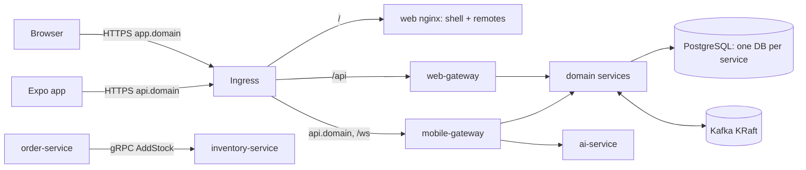
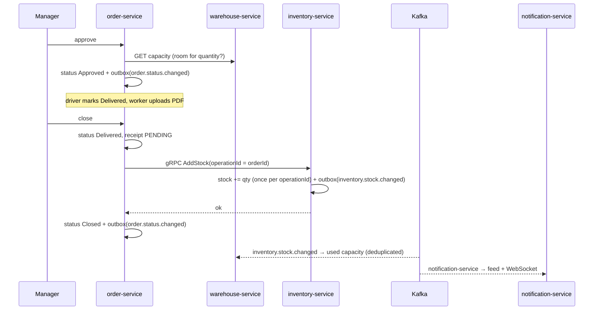

# Architecture

This page describes the **target** architecture from the approved
[remediation plan](plans/remediation-plan.md). Where the code does not match yet, the
"Status" column says which phase changes it. The [project review](PROJECT_REVIEW_AND_DOCUMENTATION.md)
describes the code as it was on 2026-10-04.

## Style
Polyglot microservices in one monorepo: 9 domain services behind 2 backend-for-frontend gateways
(ADR 001). Each service owns its database (ADR 002). Calls that need an answer right away use gRPC
(only the stock command); everything else that crosses a service boundary after the fact is a
Kafka event, published from a transactional outbox (ADR 003, ADR 004).

## Structure

| Folder | What | Tech |
|---|---|---|
| `backend/services/auth-service` | users, roles, login, tokens, JWKS | Spring Boot |
| `backend/services/company-service` | supplier/partner companies | Spring Boot |
| `backend/services/warehouse-service` | warehouses, capacity projection (consumes stock events) | Spring Boot |
| `backend/services/inventory-service` | stock, thresholds, consumption; gRPC server | Spring Boot |
| `backend/services/fleet-service` | drivers, vehicles | ASP.NET Core |
| `backend/services/product-service` | products, categories, SKU lookup | ASP.NET Core |
| `backend/services/order-service` | supply orders, state machine, delivery documents; gRPC client | ASP.NET Core |
| `backend/services/notification-service` | notification feed, per-user read state, WebSocket, push tokens | Express/TS |
| `backend/services/ai-service` | inventory analytics, reorder suggestions (stateless) | Express/TS |
| `backend/gateways/web-gateway` | web edge: cookie auth, routing, coarse role checks | Spring Cloud Gateway |
| `backend/gateways/mobile-gateway` | mobile edge: Bearer auth, response shaping, WebSocket proxy | Express/TS |
| `frontend/web` | shell (Module Federation host) + 7 remotes | React 19.1, Vite 5 |
| `frontend/mobile` | native app | Expo 54 |
| `frontend/packages` | `api-types` (generated from contracts), `domain` (roles, permission mirror), `i18n` | TypeScript |
| `contracts/` | OpenAPI per service, `inventory.proto`, event JSON Schemas | |
| `deploy/` | local launcher compose, k8s base and overlays, VPS scripts | |

## Rules
- A service owns its data. No service reads or writes another service's database.
- Services talk only through APIs and the proto in /contracts, or Kafka events with a schema in
  /contracts/events.
- No shared library with business logic. Shared code is generated from contracts, plus the
  frontend's pure helpers.
- Every service verifies identity and permissions itself. "Internal" does not mean trusted.
- Every service has its own Dockerfile, tests, CI workflow, README, `/healthz` and `/readyz`.

## Runtime

- Only the ingress is public. Services are ClusterIP; NetworkPolicies allow only the calls drawn
  above (phase 8).
- Kubernetes everywhere: kind in CI, k3s on the VPS, same Kustomize base (ADR 010).
- The local launcher (`run-local.sh`) runs infrastructure in Docker and the apps on the host for
  fast development.

## Identity (ADR 005, phase 3)

| Step | What happens |
|---|---|
| Login | auth-service checks the password (BCrypt) and issues an **access token** (ES256 JWT, 15 min, claims `sub`, `role`, `email`, `typ=access`, `aud=erp`, `kid`) and a **refresh token** (opaque, stored hashed, rotated on every use, revoked on logout). |
| Web | Both tokens travel in httpOnly, Secure, SameSite=Strict cookies, set by auth-service through the web gateway. The browser never sees a token. |
| Mobile | Tokens are returned in the body and kept in the device's secure store; requests send `Authorization: Bearer`. |
| Verification | auth-service publishes its public keys at `/.well-known/jwks.json` (internal only). The gateways and every service fetch and cache them and check signature, expiry, audience and `typ=access`. |
| WebSocket | A short-lived single-use ticket (`/notifications/ws-ticket`), bound to the user. |

Status: today a shared HS256 secret is hard-coded in the web gateway and role checks are commented
out (R02, R03). Phase 3 replaces both.

## Order and stock flow (ADR 007, phase 4)

Status: today stock is added on Approve, can be added twice, and failures are ignored (R04, R05, R06).

## Events (ADR 003, ADR 004)

| Topic | Producer | Consumers | Payload (schema in contracts/events) |
|---|---|---|---|
| `order.created` | order | notification | order id, product, warehouse, quantity, driver |
| `order.status.changed` | order | notification | order id, old and new status, actor, time |
| `inventory.stock.changed` | inventory | warehouse, notification | product, warehouse, signed delta, new quantity, reason, operation id |
| `inventory.stock.low` / `inventory.stock.out` | inventory | notification | product, warehouse, quantity, threshold |
| `warehouse.capacity.low` / `warehouse.capacity.full` | warehouse | notification | warehouse, used, total |
| `<topic>.dlq` | consumers | operators | the failed message + error |

Every message uses the envelope `{ id, type, version, occurredAt, source, payload }`. Consumers
store processed `id`s and skip duplicates.

## Pipeline

| Workflow | Runs when | Does |
|---|---|---|
| `_java-service.yml`, `_dotnet-service.yml`, `_node-service.yml`, `_web.yml` | called by service workflows | install, lint, typecheck, migrate, unit + integration tests (Testcontainers), coverage, audit, Semgrep, image build, Trivy |
| `<service>.yml` | the service's folder or contracts change | the matching reusable pipeline |
| `repo-checks.yml` | every PR | gitleaks (full history), Redocly, buf lint/breaking, actionlint |
| `e2e.yml` | every PR to main | full stack in kind → Playwright API + browser tests |
| `release.yml` | push to main | build, scan, push images to GHCR by digest, deploy to the VPS (manual approval) |

Status: phase 1 replaces the single `ci.yml` with this layout.
